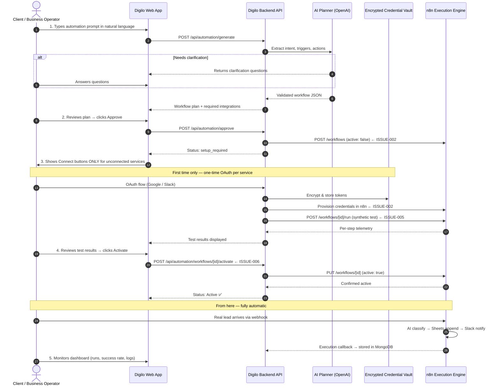
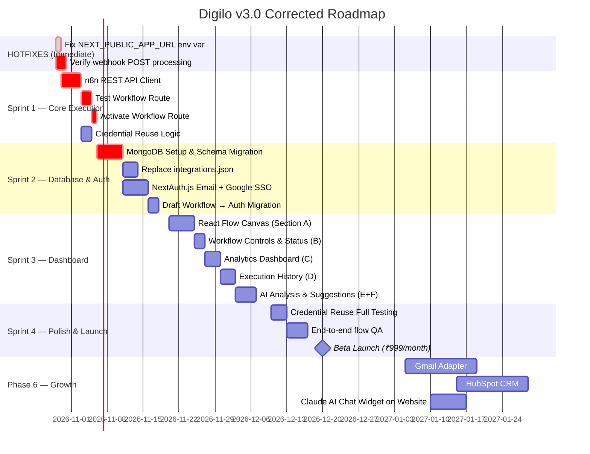

# DIGILO AI AUTOMATION PLANNER — PRODUCT REQUIREMENTS DOCUMENT (PRD)

**Document Version:** 3.1.0
**Status:** Active Development — Full Design System + Issues + Roadmap
**Author:** Senior Product Manager, SaaS Architect & Workflow Automation Specialist
**Last Updated:** October 29, 2026
**Previous Version:** 3.0.0 (October 29, 2026)
**Target Audience:** Engineering, Product, Design, Operations, and Security Teams

---

## ⚠️ VERSION 3.1 CHANGELOG (from v3.0)

> Added complete UI/UX Design System, all 5 page specifications, Antigravity design prompt reference, AI chatbot spec, and end-to-end user flow documentation.

---

## 🎨 SECTION 0: DESIGN SYSTEM & UI SPECIFICATIONS

### 0.1 Visual Identity

| Token | Value | Usage |
| :--- | :--- | :--- |
| `--color-bg-primary` | `#0A0A0A` | Page backgrounds |
| `--color-bg-card` | `#111111` | Cards, panels |
| `--color-bg-elevated` | `#1A1A1A` | Modals, dropdowns |
| `--color-accent-lime` | `#C8FF00` | CTAs, active states, success, brand |
| `--color-accent-amber` | `#FFD600` | Warnings, setup required, pending |
| `--color-text-primary` | `#FFFFFF` | Headlines, primary text |
| `--color-text-secondary` | `#A0A0A0` | Descriptions, labels |
| `--color-text-muted` | `#555555` | Placeholders, disabled |
| `--color-border` | `#222222` | Card borders |
| `--color-border-active` | `#C8FF00` | Active/focused inputs |
| `--color-success` | `#22C55E` | Connected, success |
| `--color-error` | `#EF4444` | Failed, error |

**Typography:**
- Headings: Inter Bold
- Body: Inter Regular, 14–16px
- Status labels & code: JetBrains Mono (UPPERCASE)
- Logo: Bold, white, wide letter-spacing

**Design Language:**
- Dark terminal aesthetic meets modern SaaS
- Border-radius: max 8px — sharp, not bubbly
- Subtle lime glow on connected/active states
- No decorative elements — every pixel serves function
- All status badges: UPPERCASE monospace

---

### 0.2 Component Library

#### Status Badges
```
ACTIVE          → lime bg, black text
DRAFT           → gray bg, white text
SETUP REQUIRED  → amber bg, black text
FAILED          → red bg, white text
PAUSED          → gray outline, white text
TESTING         → blue pulse, white text
```

#### Integration State Badges
```
CONNECTED       → lime dot + "CONNECTED" monospace
READY           → lime dot + "READY" monospace
SETUP REQUIRED  → amber dot + "SETUP REQUIRED" monospace
EXPIRED         → red dot + "EXPIRED" monospace
NOT CONNECTED   → gray dot + "NOT CONNECTED" monospace
```

#### Buttons
```
Primary CTA     → lime bg (#C8FF00), black text, bold
Secondary       → dark bg, white border, white text
Warning action  → dark bg, amber border, amber text
Destructive     → dark bg, red border, red text
Disabled        → opacity 0.4, no pointer events
```

---

### 0.3 Page Inventory

| Route | Page Name | Status |
| :--- | :--- | :--- |
| `/` | Landing / Home | Design ready |
| `/automation` | AI Automation Builder | Design ready |
| `/auth` | Login / Sign Up | Design ready |
| `/dashboard` | Workflow List | Design ready |
| `/dashboard/workflows/[id]` | Workflow Detail | Design ready |

---

### 0.4 Full End-to-End User Flow

```
NEW USER:
Landing Page (/)
    ↓ [Start Building Free]
/automation — types prompt
    ↓ [Generate Automation]
AI generates steps + required integrations shown
    ↓ [Approve Workflow]
Auth Modal: "Save your workflow — sign up free"
    ↓ Signs up / logs in
/dashboard/workflows/[new-id]
    ↓ Sees workflow canvas + SETUP REQUIRED status
Clicks [Connect Google Sheets] → OAuth flow → CONNECTED ✅
Clicks [Connect Slack] → OAuth flow → CONNECTED ✅
    ↓ All integrations connected
Clicks [TEST WORKFLOW] → n8n dry run → step results shown
    ↓ Test passes
Clicks [ACTIVATE TO PRODUCTION] → workflow goes ACTIVE ✅
    ↓
Client configures website form → POSTs to webhook URL
Real leads flow in → AI classifies → Sheets updated → Slack notified
    ↓
Dashboard shows real analytics, execution history, AI analysis

RETURNING USER (already logged in):
/automation → new prompt → generate → Approve
→ /dashboard/workflows/[new-id]
→ Existing integrations auto-reused (no reconnect needed)
→ Test → Activate → Live
```

---

### 0.5 Page Specifications

#### PAGE 1: Landing Page (`/`)

**Navbar:**
- Logo "DIGILO" (left)
- Links: AI Automations | Dashboard | Services | Work | About (center)
- Right: [Login] text link + [Get Started →] lime filled button

**Hero Section:**
- Headline: "Automate Your Business. Just Describe It." (large, centered, white)
- Sub: "Type what you want automated. DIGILO AI builds the workflow, connects your tools, and makes it live — in minutes."
- CTAs: [Start Building Free →] (lime) + [Watch Demo] (outline)
- Trust text: "No credit card. No code. No technical skills needed."
- Right-side animation: terminal typing → workflow nodes appearing

**How It Works (3 steps):**
1. "Describe your automation" — chat bubble icon
2. "AI builds your workflow" — nodes icon
3. "Connect & Go Live" — lightning bolt icon

**Integrations Row:** Logos of Webhook, OpenAI, Google Sheets, Slack, Gmail (Coming Soon)

**Pricing Section (3 cards):**

| Plan | Price | Limit |
| :--- | :--- | :--- |
| Starter | ₹999/month | 3 workflows |
| Growth (POPULAR) | ₹2,999/month | 10 workflows |
| Agency | ₹9,999/month | Unlimited |

---

#### PAGE 2: AI Automation Builder (`/automation`)

**Prompt Input Area:**
- Terminal-style textarea (full width, monospace font, lime border on focus)
- Placeholder: "Describe your automation in plain English..."
- [✨ Generate Automation] button — full width, lime

**Post-Generation Layout (2 columns):**

Left column — Workflow Steps:
- Each step = dark card with:
  - Step number (lime circle)
  - Integration icon (colored)
  - Step name + description
  - Integration badge (monospace)
- Directed arrows between steps

Right column — Required Integrations:
- Each integration = badge row with icon, name, status

**3 Bottom Action Buttons (full-width row):**

| Button | Style | Behavior |
| :--- | :--- | :--- |
| 🔄 REGENERATE | Dark, white border | Re-runs AI, clears state |
| ✏️ EDIT STEPS | Dark, amber border | Opens inline step editor |
| ✅ APPROVE WORKFLOW | Lime filled | If not logged in → auth modal; if logged in → /dashboard/workflows/[id] |

**Auth Modal (on Approve if not logged in):**
- "Save Your Workflow"
- "Create a free account to save and activate your automation."
- [Continue with Google] + [Sign up with Email]
- "Your workflow is saved and will be waiting in your dashboard."

**Loading States (during AI generation):**
```
"Analyzing your request..."     → 500ms
"Building workflow steps..."    → 1000ms
"Validating integrations..."    → 500ms
→ Result appears
```

**Clarification Flow:**
- If AI needs more info → show clarification card with 2-3 specific questions
- User answers → re-submit → get result

---

#### PAGE 3: Auth (`/auth`)

**Split layout:**
- Left: Dark background, animated workflow nodes, DIGILO branding
- Right: Form (email + password, Google OAuth, toggle login/signup)

**After login → redirect to `/dashboard` or back to workflow draft**

---

#### PAGE 4: Dashboard — Workflow List (`/dashboard`)

**Sidebar (collapsible):**
- Logo
- Nav: 🤖 AI Automations | 📊 Dashboard | 🔌 Integrations | ⚙️ Settings
- Bottom: User info + Logout

**Main Content:**
- Header: "MY AUTOMATIONS" + stats chips (3 Active | 1 Draft | 0 Failed)
- [+ New Automation] button (top-right, lime)
- Workflow cards grid (2-col desktop, 1-col mobile):
  - Workflow name
  - Status badge
  - Integration icons
  - Run stats: "42 runs · 98% success · Last run: 2 mins ago"
  - [View Details →] button

**Empty State:**
- Simple node graph SVG illustration
- "No automations yet"
- [+ Create Your First Automation] (lime, large)

---

#### PAGE 5: Workflow Detail (`/dashboard/workflows/[id]`)

**Sticky breadcrumb navbar:** Dashboard → My Automations → [Workflow Name]

**SECTION A — VISUAL WORKFLOW CANVAS (TOP, MANDATORY):**

Canvas specs:
- Background: `#0D0D0D` with dot grid
- Nodes: left-to-right horizontal flow
- Trigger node: lime left-border, webhook icon, event name
- Action nodes: dark card, integration icon, step name + destination
- Edges: directed arrows with subtle animation
- Version badge: top-right (`v1.0 — ACTIVE` lime | `DRAFT` gray dashed)
- Click any node → right drawer opens with step parameters
- Top buttons: [View Details] [Edit Settings] (small, outline)

**Node types:**
```
TriggerNode:
  ┌─────────────────────────────┐
  │ 🔗 TRIGGER                  │ ← lime left border
  │ Website Webhook             │
  │ Receives: lead_submitted    │
  └─────────────────────────────┘

ActionNode:
  ┌─────────────────────────────┐
  │ 🤖 STEP 1 — AI             │
  │ AI Lead Analysis            │
  │ Classifies: Hot/Warm/Cold   │
  └─────────────────────────────┘
```

**SECTION B — CONTROLS & STATUS:**
- Status badge (large)
- Required integrations bar (badges with live states)
- Control buttons:
  - [⚡ TEST WORKFLOW]
  - [▶ ACTIVATE TO PRODUCTION] (disabled until all connected + test passed)
  - [⏸ PAUSE] (when active)
- Activation blocked banner (amber, if applicable)

**SECTION C — ANALYTICS:**
- Time filter: [24H] [7D] [30D] [CUSTOM]
- 4 metric cards: Total Runs | Success Rate | Avg Duration | Leads Ingested
- Bar chart: runs per day (lime bars)
- Count tiles: Sheets Rows Written | Slack Notifications Sent
- **RULE: All numbers from real DB. Zero fabricated data. Empty state if 0 runs.**

**SECTION D — EXECUTION HISTORY:**
- Table: Timestamp | Duration | Status | Trigger Event | [View Details]
- Expandable rows → per-step breakdown with timing, output summary
- PII redaction: `j***@company.com`
- Failed steps: human-readable error + remediation hint + [Retry] if eligible

**SECTION E — AI WORKFLOW ANALYSIS:**
- 3 cards: "How Data Flows" | "Performance Health" | "Operational Summary"
- All labeled: "Based on X executions over the past 7 days"

**SECTION F — AI IMPROVEMENT SUGGESTIONS:**
- Evidence-based suggestions only (post 10+ runs)
- Each: Opportunity | Evidence | Proposed Change | Benefit | Trade-offs
- Actions: [Review Changes] | [Apply as Draft v1.1] | [Dismiss]
- **RULE: Apply = new draft version only, never overwrites active**

---

### 0.6 Floating AI Chat Bot (All Pages)

**Position:** Fixed, bottom-right, z-index top

**Default state:**
- Circular lime button, 56px diameter
- DIGILO robot/brain icon inside
- Subtle pulse animation ring

**Expanded state (click to open):**
- 380×500px card, dark bg, lime header
- Title: "DIGILO AI Assistant"
- Chat history area
- User messages: right-aligned, lime bg, black text
- AI messages: left-aligned, dark card, white text
- Quick question chips: "How do I connect Google Sheets?" | "What is a webhook?" | "Why is my test failing?"
- Input field + [Send] button
- Typing indicator (animated dots)

**Bot capabilities:**
- Answer questions about the platform
- Guide users through connection steps
- Explain workflow concepts
- Troubleshoot common errors
- Never perform account actions directly

---

### 0.7 Integration Connect Modal Flow

**Trigger:** User clicks [Connect Google Sheets] or [Connect Slack]

**Step 1 — Permission Explainer:**
```
┌──────────────────────────────────────────┐
│   [Google Sheets Logo]                   │
│   Connect Google Sheets                  │
│                                          │
│   DIGILO needs access to:                │
│   ✓ Read and write spreadsheet data      │
│   ✓ List your spreadsheets              │
│                                          │
│   [Authorize with Google →]  (lime)      │
│   [Cancel]                               │
│                                          │
│   Your credentials are encrypted         │
│   and never shared with third parties.   │
└──────────────────────────────────────────┘
```

**Step 2 — Resource Selector (Google Sheets):**
- Dropdown: "Select Spreadsheet"
- After selection: "Select Worksheet/Tab"
- Preview: "Rows will be added to: Lead CRM → Leads"
- [Confirm & Save] button

**Step 2 — Resource Selector (Slack):**
- Dropdown: "Select Channel" (lists all accessible)
- Preview: "Notifications sent to: #leads"
- [Confirm & Save] button

**Success State:**
- Checkmark animation (lime)
- "Connected! Google Sheets is ready."
- Auto-close → badge updates to CONNECTED

---

### 0.8 Responsive Breakpoints

| Breakpoint | Behavior |
| :--- | :--- |
| Mobile < 768px | Single column, hamburger nav, vertical buttons, full-screen chat |
| Tablet 768–1024px | 2-column where applicable, horizontal canvas with scroll |
| Desktop > 1024px | Full layouts, sidebar visible, 2-col canvas + detail |

---

### 0.9 Micro-Interactions

- Textarea: lime border glow on focus
- Generate button: loading spinner + progress text
- Workflow steps: staggered slide-in (100ms delay each)
- Active status badge: subtle pulse
- Connected badge: checkmark bounce animation
- Canvas nodes: scale spring animation on load
- Chat widget: slide-up from bottom-right
- Page transitions: 150ms fade
- Success states: brief lime flash on cards

---

## ⚠️ VERSION 3.0 CHANGELOG (from v2.0)

> This version documents **all currently identified bugs, gaps, and broken flows** found during live testing on October 29, 2026, and restructures the roadmap accordingly. All `EXISTING & VERIFIED` claims from v2.0 have been re-audited.

---

## 🔴 CRITICAL ISSUES LOG (Must Fix Before Any Beta Launch)

### ISSUE-001 — Webhook URL Resolves to Localhost (BLOCKER)
- **Severity**: P0 — BLOCKER
- **Location**: Webhook intake URL displayed in dashboard
- **Observed**: `http://localhost:3000/api/v1/intake/ws_.../wf_...` shown to users
- **Impact**: External websites, WordPress forms, and any real client cannot reach this URL. The entire lead-intake flow is non-functional in any real-world scenario.
- **Root Cause**: `NEXT_PUBLIC_APP_URL` environment variable not set; defaults to localhost.
- **Fix Required**:
  ```env
  # .env.local (development)
  NEXT_PUBLIC_APP_URL=https://digilo.space

  # Production server
  NEXT_PUBLIC_APP_URL=https://digilo.space
  ```
- **Verification**: Dashboard must show `https://digilo.space/api/v1/intake/...` after fix.
- **Owner**: DevOps / Backend
- **ETA**: 1 hour

---

### ISSUE-002 — n8n Execution Engine Not Connected (BLOCKER)
- **Severity**: P0 — BLOCKER
- **Location**: Dashboard → "N8N REMOTE ENGINE — OPTIONAL (UNCONFIGURED)"
- **Observed**: n8n shows as "OPTIONAL" and unconfigured in current dashboard. The entire execution pipeline (test, activate, live runs) depends on n8n being connected.
- **Impact**:
  - "TEST WORKFLOW" button cannot actually execute anything
  - "ACTIVATE TO PRODUCTION" is permanently blocked
  - No real automation runs exist — platform is effectively a workflow JSON generator only
- **Root Cause**: Live n8n REST API Client (`Phase 3` in v2.0 PRD) is `PROPOSED` and not built.
- **Fix Required**:
  1. Set environment variables:
     ```env
     N8N_API_URL=https://your-n8n-instance.com
     N8N_API_KEY=your-n8n-api-key
     ```
  2. Build `src/lib/n8n/client.ts` — HTTP client for n8n REST API
  3. Implement `POST /api/v1/workflows` → provision workflow in n8n as inactive
  4. Implement `POST /api/v1/workflows/[id]/run` → trigger dry-run test
  5. Implement `PUT /api/v1/workflows/[id]/activate` → go live
- **Owner**: Backend Engineering
- **ETA**: 3–5 days

---

### ISSUE-003 — No Real Database Persistence (BLOCKER)
- **Severity**: P0 — BLOCKER
- **Location**: `src/lib/automation/storage/integration-store.ts` → `.data/integrations.json`
- **Observed**: All credential storage, workflow state, and session data is in local JSON files on the server filesystem.
- **Impact**:
  - Any server restart wipes all connected integrations and workflow state
  - Multi-user / multi-workspace is impossible with file-based storage
  - Cannot scale — single-threaded file writes cause race conditions under concurrent load
  - Data loss risk is 100% on any deployment or crash
- **Fix Required**:
  - Install `mongoose` or MongoDB Node Driver
  - Provision MongoDB Atlas cluster (or self-hosted)
  - Migrate all collections per Section 8 schemas: `users`, `workspaces`, `workflows`, `executions`, `metrics`
  - Replace all `integrations.json` read/write calls with MongoDB queries
- **Owner**: Backend Engineering
- **ETA**: 5–7 days

---

### ISSUE-004 — No Real Authentication System (HIGH)
- **Severity**: P1 — HIGH
- **Location**: `src/lib/automation/storage/workspace-session.ts`
- **Observed**: Only a cookie-based workspace session exists. No login, no signup, no password, no email verification, no session expiry management.
- **Impact**:
  - Cannot support multiple real users
  - Any user who clears cookies loses all their workflows and connections
  - No secure user identity = impossible to bill or manage subscriptions
  - Workspace IDs are not bound to authenticated identities
- **Fix Required**:
  - Implement NextAuth.js with email/password + Google SSO providers
  - Bind `workspaceId` to authenticated `userId` on registration
  - Migrate unauthenticated draft cookie → authenticated workspace on login
  - Add session middleware to all protected API routes
- **Owner**: Full-Stack Engineering
- **ETA**: 5–7 days

---

### ISSUE-005 — TEST WORKFLOW Does Nothing (HIGH)
- **Severity**: P1 — HIGH
- **Location**: Dashboard → "TEST WORKFLOW" button
- **Observed**: Button is present in UI but backend route `POST /api/automation/workflows/[id]/test` is `PROPOSED` and not implemented. Clicking it produces no real execution.
- **Impact**:
  - Users cannot validate their workflow before activation
  - "Activation Blocked" message is permanent — no path to go live
  - Core demo/sales flow is completely broken
- **Fix Required**: Depends on ISSUE-002 (n8n client). Once n8n is connected:
  1. Build `/api/automation/workflows/[id]/test` route
  2. Send synthetic payload to n8n manual execution endpoint
  3. Return per-step telemetry to UI
  4. Mark workflow as `test_passed` on success
- **Owner**: Backend Engineering
- **Blocked By**: ISSUE-002

---

### ISSUE-006 — ACTIVATE TO PRODUCTION Does Nothing (HIGH)
- **Severity**: P1 — HIGH
- **Location**: Dashboard → "ACTIVATE TO PRODUCTION" button
- **Observed**: Button exists but `POST /api/automation/workflows/[id]/activate` is `PROPOSED` and not built. Status never transitions from `DRAFT` to `ACTIVE`.
- **Impact**: Platform can never go live for any client
- **Fix Required**: Depends on ISSUE-002 and ISSUE-005. After test passes:
  1. Verify all integrations connected
  2. Call n8n `PUT /workflows/[id]` with `{ active: true }`
  3. Update workflow status in DB to `active`
  4. Enable webhook reception
- **Owner**: Backend Engineering
- **Blocked By**: ISSUE-002, ISSUE-005

---

### ISSUE-007 — Dashboard Has No Real Data (MEDIUM)
- **Severity**: P2 — MEDIUM
- **Location**: `/dashboard/workflows/[id]` — Sections C, D, E, F
- **Observed**: Dashboard sections for Analytics (C), Execution History (D), AI Analysis (E), and AI Suggestions (F) are either empty, missing, or showing placeholder/static UI with no real data.
- **Impact**:
  - Clients cannot monitor their automations
  - No visibility into what is working or broken
  - No trust signals for paying customers
- **Fix Required**:
  - Build n8n execution callback receiver
  - Aggregate execution records into MongoDB `executions` collection
  - Build analytics API: `GET /api/automation/workflows/[id]/analytics`
  - Build execution history API: `GET /api/automation/workflows/[id]/executions`
  - Render real data in Sections C–F (zero fabricated numbers — empty state if no runs)
- **Owner**: Full-Stack Engineering
- **Blocked By**: ISSUE-002, ISSUE-003

---

### ISSUE-008 — Visual Workflow Canvas (Section A) Missing (MEDIUM)
- **Severity**: P2 — MEDIUM
- **Location**: `/dashboard/workflows/[id]` — top of page
- **Observed**: PRD Section 4.1 mandates a React Flow interactive node canvas at the very top. Currently shows step cards only, not a visual graph.
- **Impact**: Core product differentiator (visual workflow view) is absent. Feels like a form, not a workflow platform.
- **Fix Required**:
  - Integrate `react-flow` library
  - Build node components: TriggerNode, ActionNode, EdgeConnector
  - Render saved workflow JSON as visual graph
  - Add click-to-inspect drawer for step parameters
  - Show version badge: Active Production vs Draft
- **Owner**: Frontend Engineering
- **ETA**: 4–5 days (independent of backend fixes)

---

### ISSUE-009 — OAuth Credential Reuse Not Guaranteed Across Workflows (MEDIUM)
- **Severity**: P2 — MEDIUM
- **Location**: Credential binding when second workflow is approved
- **Observed**: When a second workflow is approved that requires Google Sheets, it is not confirmed that existing stored credentials are automatically reused without requiring the user to reconnect.
- **Impact**: Users may have to reconnect Google/Slack for every new workflow — extremely poor UX and against the "one-time connect" vision.
- **Fix Required**:
  - On workflow approval, check `integrations.json` (→ MongoDB post ISSUE-003 fix) for existing valid tokens
  - If token exists and not expired → auto-bind to new workflow (no reconnect)
  - Only show "Connect" button if: first time, token expired, or scope mismatch
  - n8n credential provisioning must reuse existing `n8nCredentialId` if already created
- **Owner**: Backend Engineering

---

### ISSUE-010 — Webhook Intake Has No Live Processing Logic (HIGH)
- **Severity**: P1 — HIGH
- **Location**: `GET /api/v1/intake/[workspaceId]/[workflowId]` — returns healthy, but POST handling is unclear
- **Observed**: GET request to intake URL returns `{ status: "healthy" }` correctly. However, POST with actual lead JSON has not been verified to:
  1. Parse and validate incoming payload
  2. Trigger the associated workflow in n8n
  3. Return correct HTTP 200 acknowledgment immediately (async)
  4. Record the execution in database
- **Impact**: Even if a client configures their form to POST to Digilo, nothing meaningful happens
- **Fix Required**:
  1. Verify `POST /api/v1/intake/[workspaceId]/[workflowId]` handler exists and parses body
  2. Immediately return HTTP 200 (async queue — don't wait for n8n)
  3. Forward payload to n8n via internal webhook or manual trigger
  4. Record trigger event in `executions` collection
  5. Add HMAC signature verification for authenticated webhooks
- **Owner**: Backend Engineering
- **Blocked By**: ISSUE-002

---

## 📋 RE-AUDITED CAPABILITY MATRIX (v3.0)

| Component / Feature | v2.0 Claim | v3.0 Verified Status | Issues |
| :--- | :--- | :--- | :--- |
| **Dynamic Integration Catalog** | `EXISTING & VERIFIED` | ✅ CONFIRMED | None |
| **Intent-Based AI Planner** | `EXISTING & VERIFIED` | ✅ CONFIRMED | None |
| **Workflow Schema & Deep Validator** | `EXISTING & VERIFIED` | ✅ CONFIRMED | None |
| **AES-256-GCM Token Encryption** | `EXISTING & VERIFIED` | ✅ CONFIRMED | None |
| **OAuth State Tamper Protection** | `EXISTING & VERIFIED` | ✅ CONFIRMED | None |
| **Google Sheets OAuth 2.0** | `EXISTING & VERIFIED` | ✅ CONFIRMED | None |
| **Slack OAuth 2.0** | `EXISTING & VERIFIED` | ✅ CONFIRMED | None |
| **Credential Storage (Workspace-Scoped)** | `EXISTING & VERIFIED` | ⚠️ PARTIAL — FILE ONLY | ISSUE-003 |
| **n8n Export & Executability Engine** | `EXISTING & VERIFIED` | ✅ JSON export confirmed | Live execution: ISSUE-002 |
| **Automated Regression Test Suite** | `EXISTING & VERIFIED` | ✅ CONFIRMED (30 tests) | None |
| **Planner UI & Review Interface** | `EXISTING & VERIFIED` | ✅ CONFIRMED | None |
| **Webhook Intake URL** | `EXISTING & VERIFIED` | 🔴 BROKEN — localhost only | ISSUE-001 |
| **TEST WORKFLOW Button** | Implied complete | 🔴 NOT FUNCTIONAL | ISSUE-005 |
| **ACTIVATE TO PRODUCTION** | Implied complete | 🔴 NOT FUNCTIONAL | ISSUE-006 |
| **Live n8n REST API Orchestrator** | `PROPOSED` | ❌ NOT BUILT | ISSUE-002 |
| **MongoDB Persistence Layer** | `PROPOSED` | ❌ NOT BUILT | ISSUE-003 |
| **Client Authentication & Sessions** | `PROPOSED` | ❌ NOT BUILT | ISSUE-004 |
| **Client Dashboard Sections C–F** | `PROPOSED` | ❌ NOT BUILT | ISSUE-007 |
| **Visual Workflow Canvas (React Flow)** | `PROPOSED` | ❌ NOT BUILT | ISSUE-008 |
| **Gmail OAuth & Action Adapter** | `PROPOSED` | ❌ NOT BUILT | — |
| **Credential Reuse Across Workflows** | Not documented | ⚠️ UNVERIFIED | ISSUE-009 |
| **Webhook POST Processing** | Not documented | ⚠️ UNVERIFIED | ISSUE-010 |
| **Arbitrary Website Admin Connect** | `NOT IMPLEMENTED` | ✅ Correctly excluded | — |

---

## 1. Executive Summary & Product Vision

### 1.1 Executive Summary
**DIGILO AI AUTOMATION** is an enterprise-grade, conversational workflow orchestration platform designed for modern business operations. It allows non-technical business operators, founders, and agency leads to express business workflow automation needs in natural language, review a deterministic and validated automation plan, safely authorize required third-party services, execute sandboxed tests, and monitor live automations from a unified client dashboard — all without ever interacting with the underlying execution engine (n8n).

DIGILO sits as the intelligent **Control Plane**, while a dedicated n8n instance operates as the isolated **Data Plane / Execution Engine**.

### 1.2 Product Vision
The paradigm shifts from "building workflows through node configuration" to **"describing business outcomes in natural language."**

A client describes:
> *"When a new lead arrives through my website webhook, analyze the lead using AI to compute an urgency score and summary, save the result to Google Sheets, and notify my sales team on Slack."*

DIGILO deterministically:
1. Detects required integrations and actions without hallucination.
2. Formulates a schema-valid workflow graph.
3. Requests authorization **only** for services required by that workflow.
4. Stages an inactive, encrypted workflow in the execution engine.
5. Runs safe, isolated dry-run tests **automatically**.
6. Activates the workflow upon explicit client approval.
7. Surfaces verified telemetry, per-step execution logs, and AI optimization suggestions within a client dashboard.

### 1.3 "One-Time Connect, Always Automatic" Experience

> **Core UX Principle**: OAuth authorization requires a one-time user action per service (Google, Slack) — this is a security requirement by the providers and cannot be bypassed. After that first connection, **all future workflows using the same service are fully automatic** — no reconnection, no manual steps.

```
FIRST TIME (one-time per integration):
  User → approves workflow
  User → clicks "Connect Google Sheets" → authorizes on Google
  User → clicks "Connect Slack" → authorizes on Slack
  Tokens saved in encrypted vault ✅

ALL FUTURE WORKFLOWS (fully automatic):
  User → types prompt
  AI   → generates plan
  User → reviews & clicks Approve
         ↓ (automatic from here)
  n8n  → workflow provisioned (inactive)
  Test → runs automatically with synthetic payload
  n8n  → activated if test passes
  Live → webhook receives real leads
  Google Sheets → rows appended automatically
  Slack → notifications sent automatically
```

### 1.4 Technology Direction (Unchanged from v2.0)
- **Frontend Core**: Next.js 16 (App Router), React 19, Tailwind CSS, Framer Motion, Lucide Icons, React Flow
- **Backend & APIs**: Next.js Route Handlers, Zod schema validators, cryptographic utilities
- **AI Planning Engine**: OpenAI API / NVIDIA `/v1` with structured JSON outputs and negative prompt guardrails
- **Database Layer**: MongoDB (Mongoose) — **migration from local JSON files is P0**
- **Workflow Execution Engine**: n8n (self-hosted) via server-side REST API only
- **Supported Integrations**: Webhook, Manual, OpenAI, Google Sheets, Slack, Gmail (Phase 6)

---

## 2. Current State Assessment (October 29, 2026)

### 2.1 What Is Actually Working
| Feature | Evidence |
| :--- | :--- |
| AI prompt → workflow JSON generation | Tested and verified |
| Intent extraction & negative filtering | 30 regression tests passing |
| Google Sheets OAuth connect flow | User connected successfully in testing |
| Slack OAuth connect flow | User connected successfully in testing |
| AES-256-GCM token encryption | Test suite verified |
| Workflow schema validation (Zod) | Test suite verified |
| n8n JSON export format | Generates valid n8n workflow JSON |
| Webhook endpoint returns healthy | GET request confirmed healthy |

### 2.2 What Is Broken or Missing
| Feature | Status | Priority |
| :--- | :--- | :--- |
| Webhook URL uses localhost | 🔴 Broken | P0 |
| n8n not connected | 🔴 Not built | P0 |
| TEST WORKFLOW non-functional | 🔴 Not functional | P0 |
| ACTIVATE TO PRODUCTION non-functional | 🔴 Not functional | P0 |
| Database uses local JSON files | 🔴 Data loss risk | P0 |
| No real login / user auth | 🔴 Not built | P1 |
| Dashboard analytics empty | ❌ Not built | P1 |
| Execution history empty | ❌ Not built | P1 |
| React Flow canvas missing | ❌ Not built | P2 |
| Credential reuse unverified | ⚠️ Unknown | P1 |
| Webhook POST processing unverified | ⚠️ Unknown | P1 |

### 2.3 Overall Platform Completion
```
AI Planning Engine     ████████░░  85%  ✅ Strong
OAuth & Vault          █████████░  90%  ✅ Strong
n8n JSON Export        ████████░░  80%  ✅ Strong
Live n8n Execution     █░░░░░░░░░  10%  🔴 Critical gap
Client Dashboard       ██░░░░░░░░  15%  🔴 Critical gap
Auth / Database        ██░░░░░░░░  20%  🔴 Critical gap
Analytics / Telemetry  ░░░░░░░░░░   0%  ❌ Not started
Gmail Adapter          █░░░░░░░░░   5%  ⏳ Later phase

OVERALL: ~38% Complete toward full product vision
```

---

## 3. End-to-End Client Journey (Target State — Post All Fixes)



---

## 4. Immediate Fix Roadmap (Priority Order)

### Sprint 1 — Make Platform Functional (Week 1)

#### Fix 1: Environment Variable (1 hour)
```env
# .env.local
NEXT_PUBLIC_APP_URL=https://digilo.space
N8N_API_URL=https://your-n8n.com
N8N_API_KEY=your_api_key_here
TOKEN_ENCRYPTION_KEY=your_32_byte_hex_key
```

#### Fix 2: n8n REST API Client (2–3 days)
Create `src/lib/n8n/client.ts`:
```typescript
export class N8nClient {
  private baseUrl: string;
  private apiKey: string;

  constructor() {
    this.baseUrl = process.env.N8N_API_URL!;
    this.apiKey = process.env.N8N_API_KEY!;
  }

  async createWorkflow(payload: N8nWorkflowPayload): Promise<{ id: string }> {
    const res = await fetch(`${this.baseUrl}/api/v1/workflows`, {
      method: 'POST',
      headers: {
        'Content-Type': 'application/json',
        'X-N8N-API-KEY': this.apiKey
      },
      body: JSON.stringify(payload)
    });
    return res.json();
  }

  async runTest(n8nWorkflowId: string, payload: object): Promise<ExecutionResult> {
    const res = await fetch(`${this.baseUrl}/api/v1/workflows/${n8nWorkflowId}/run`, {
      method: 'POST',
      headers: { 'X-N8N-API-KEY': this.apiKey, 'Content-Type': 'application/json' },
      body: JSON.stringify({ data: payload })
    });
    return res.json();
  }

  async activateWorkflow(n8nWorkflowId: string): Promise<void> {
    await fetch(`${this.baseUrl}/api/v1/workflows/${n8nWorkflowId}/activate`, {
      method: 'POST',
      headers: { 'X-N8N-API-KEY': this.apiKey }
    });
  }

  async deactivateWorkflow(n8nWorkflowId: string): Promise<void> {
    await fetch(`${this.baseUrl}/api/v1/workflows/${n8nWorkflowId}/deactivate`, {
      method: 'POST',
      headers: { 'X-N8N-API-KEY': this.apiKey }
    });
  }

  async createCredential(data: N8nCredentialPayload): Promise<{ id: string }> {
    const res = await fetch(`${this.baseUrl}/api/v1/credentials`, {
      method: 'POST',
      headers: { 'X-N8N-API-KEY': this.apiKey, 'Content-Type': 'application/json' },
      body: JSON.stringify(data)
    });
    return res.json();
  }
}
```

#### Fix 3: Test Route (1 day)
File: `src/app/api/automation/workflows/[id]/test/route.ts`
```typescript
export async function POST(req: Request, { params }: { params: { id: string } }) {
  const workspaceId = getWorkspaceId(req);
  const workflow = await getWorkflow(params.id, workspaceId);
  const n8nClient = new N8nClient();

  const syntheticPayload = generateSyntheticPayload(workflow.trigger);
  const result = await n8nClient.runTest(workflow.n8nWorkflowId, syntheticPayload);

  await saveTestResult(params.id, result);

  return Response.json({
    success: true,
    testPassed: result.status === 'success',
    stepResults: result.data.resultData.runData
  });
}
```

#### Fix 4: Activate Route (1 day)
File: `src/app/api/automation/workflows/[id]/activate/route.ts`
```typescript
export async function POST(req: Request, { params }: { params: { id: string } }) {
  const workspaceId = getWorkspaceId(req);
  const workflow = await getWorkflow(params.id, workspaceId);

  // Pre-flight checks
  const allConnected = await verifyAllIntegrationsConnected(workflow.required_integrations, workspaceId);
  if (!allConnected) {
    return Response.json({ success: false, error: 'Not all required integrations are connected.' }, { status: 400 });
  }

  const n8nClient = new N8nClient();
  await n8nClient.activateWorkflow(workflow.n8nWorkflowId);
  await updateWorkflowStatus(params.id, 'active');

  return Response.json({ success: true, status: 'active' });
}
```

---

### Sprint 2 — Database & Auth (Week 2)

#### Fix 5: MongoDB Setup
```bash
npm install mongoose
```

```typescript
// src/lib/db/mongoose.ts
import mongoose from 'mongoose';

let isConnected = false;

export async function connectDB() {
  if (isConnected) return;
  await mongoose.connect(process.env.MONGODB_URI!);
  isConnected = true;
}
```

#### Fix 6: Auth System (NextAuth.js)
```bash
npm install next-auth
```

Providers to implement:
- Email + Password (Credentials provider)
- Google OAuth (for team/enterprise accounts)

#### Fix 7: Migrate Storage
Replace all `.data/integrations.json` reads/writes with MongoDB `IntegrationCredential` model queries.

---

### Sprint 3 — Dashboard & UX (Week 3–4)

#### Fix 8: React Flow Canvas (Section A)
```typescript
// src/components/workflow-canvas.tsx
import ReactFlow, { Node, Edge } from 'reactflow';

export function WorkflowCanvas({ workflow }: { workflow: Workflow }) {
  const nodes: Node[] = [
    { id: 'trigger', type: 'triggerNode', data: workflow.trigger, position: { x: 0, y: 0 } },
    ...workflow.steps.map((step, i) => ({
      id: step.id,
      type: 'actionNode',
      data: step,
      position: { x: 0, y: (i + 1) * 120 }
    }))
  ];

  const edges: Edge[] = workflow.steps.map((step, i) => ({
    id: `e${i}`,
    source: i === 0 ? 'trigger' : workflow.steps[i - 1].id,
    target: step.id
  }));

  return <ReactFlow nodes={nodes} edges={edges} fitView />;
}
```

#### Fix 9: Analytics Dashboard (Section C)
All metrics must come from real MongoDB `executions` records.
Zero fabricated numbers. Empty state if 0 runs.

#### Fix 10: Execution History (Section D)
Paginated table from `executions` collection with redacted PII display.

---

## 5. Dynamic Integration Catalog & Adapters

*(Unchanged from v2.0 — catalog is verified and correct)*

### Supported Integrations

| Integration | Status | Auth | n8n Node |
| :--- | :--- | :--- | :--- |
| Webhook Trigger | ✅ VERIFIED | None | `n8n-nodes-base.webhook` |
| Manual Trigger | ✅ VERIFIED | None | `n8n-nodes-base.manualTrigger` |
| OpenAI / AI | ✅ VERIFIED | Server API Key | `n8n-nodes-base.openAi` |
| Google Sheets | ✅ VERIFIED | OAuth2 | `n8n-nodes-base.googleSheets` |
| Slack | ✅ VERIFIED | OAuth2 | `n8n-nodes-base.slack` |
| Gmail | ⏳ PHASE 6 | OAuth2 | `n8n-nodes-base.gmail` |
| HubSpot CRM | ⏳ FUTURE | OAuth2 | `n8n-nodes-base.hubspot` |

### Website Lead Intake Architecture
1. **Custom Websites**: `POST https://digilo.space/api/v1/intake/[workspaceId]/[webhookSecret]`
2. **WordPress**: WP Webhooks Plugin → Digilo intake URL
3. **Webflow / Typeform**: Native webhook → Digilo intake URL
4. **Security Rule**: Digilo will NEVER request CMS admin credentials. Intake is webhook-only.

---

## 6. n8n Execution Engine Architecture (Target)

### Control Plane vs Data Plane

| Layer | Component | Responsibility |
| :--- | :--- | :--- |
| Control Plane | Digilo Backend | Intent planning, validation, credential management, dashboard |
| Data Plane | n8n Instance | Actual job execution, webhook handling, retry logic |

### Workflow Full Lifecycle

```
1. Client approves workflow
         ↓
2. Digilo → POST n8n /api/v1/workflows  (active: false)
         ↓
3. Digilo → POST n8n /api/v1/credentials  (bind OAuth tokens)
         ↓
4. Client connects integrations (one-time OAuth per service)
         ↓
5. Digilo → POST n8n /api/v1/workflows/[id]/run  (dry-run test)
         ↓
6. Test passes → Client clicks Activate
         ↓
7. Digilo → POST n8n /api/v1/workflows/[id]/activate
         ↓
8. Webhook goes live → real events processed automatically
         ↓
9. n8n → execution callback → Digilo records in MongoDB
         ↓
10. Client views dashboard — real metrics, real logs
```

---

## 7. Security, Tenant Isolation & Secret Management

*(Unchanged from v2.0 — architecture is correct, pending MongoDB migration)*

### Key Points
- AES-256-GCM encryption: ✅ implemented
- HMAC-SHA256 OAuth state: ✅ implemented
- Zero client token exposure: ✅ enforced
- Workspace isolation: ⚠️ enforced in code, but file-based storage needs MongoDB for true isolation at scale
- n8n admin access: ✅ never exposed to clients

---

## 8. Data Models & Schemas

*(Unchanged from v2.0 — schemas are correct)*

### Priority Collections to Implement
1. `users` — authentication, email, hashed password
2. `workspaces` — tenant isolation, workspaceId → userId binding
3. `workflows` — workflow definitions, versions, n8nWorkflowId
4. `integrations` — encrypted credential records (replaces integrations.json)
5. `executions` — per-run records with step results
6. `metrics` — aggregated daily rollups for analytics

---

## 9. API Inventory (Updated Status)

| Endpoint | Prev Status | v3.0 Status | Notes |
| :--- | :--- | :--- | :--- |
| `POST /api/automation/generate` | VERIFIED | ✅ Working | — |
| `POST /api/automation/validate` | VERIFIED | ✅ Working | — |
| `POST /api/automation/approve` | VERIFIED | ⚠️ Partial | Stages JSON but n8n not provisioned |
| `GET /api/automation/integrations` | VERIFIED | ✅ Working | File-based storage |
| `POST /api/automation/integrations/disconnect` | VERIFIED | ✅ Working | — |
| `GET /api/automation/integrations/google/connect` | VERIFIED | ✅ Working | — |
| `GET /api/automation/integrations/google/callback` | VERIFIED | ✅ Working | — |
| `GET /api/automation/integrations/google/spreadsheets` | VERIFIED | ✅ Working | — |
| `GET /api/automation/integrations/google/sheets` | VERIFIED | ✅ Working | — |
| `POST /api/automation/integrations/google/select` | VERIFIED | ✅ Working | — |
| `GET /api/automation/integrations/slack/connect` | VERIFIED | ✅ Working | — |
| `GET /api/automation/integrations/slack/callback` | VERIFIED | ✅ Working | — |
| `GET /api/automation/integrations/slack/channels` | VERIFIED | ✅ Working | — |
| `POST /api/automation/integrations/slack/select-channel` | VERIFIED | ✅ Working | — |
| `GET /api/v1/intake/[ws]/[wf]` | Not documented | ✅ Returns healthy | GET only verified |
| `POST /api/v1/intake/[ws]/[wf]` | Not documented | ⚠️ UNVERIFIED | POST processing needs validation |
| `POST /api/automation/workflows/[id]/test` | PROPOSED | 🔴 NOT BUILT | ISSUE-005 |
| `POST /api/automation/workflows/[id]/activate` | PROPOSED | 🔴 NOT BUILT | ISSUE-006 |
| `POST /api/automation/workflows/[id]/pause` | PROPOSED | 🔴 NOT BUILT | — |
| `GET /api/automation/workflows/[id]/analytics` | PROPOSED | 🔴 NOT BUILT | ISSUE-007 |
| `GET /api/automation/workflows/[id]/executions` | PROPOSED | 🔴 NOT BUILT | ISSUE-007 |
| `POST /api/automation/workflows/[id]/retry` | PROPOSED | 🔴 NOT BUILT | — |
| `POST /api/automation/workflows/[id]/suggest` | PROPOSED | 🔴 NOT BUILT | — |

---

## 10. Updated Phased Roadmap



---

## 11. Acceptance Criteria (Updated)

| ID | Criteria | Status |
| :--- | :--- | :--- |
| AC-1 | Dynamic intent selection (AI-only prompt = no Sheets/Slack) | ✅ PASSING |
| AC-2 | Accurate workflow descriptions | ✅ PASSING |
| AC-3 | Targeted connection requests only | ✅ PASSING |
| AC-4 | Complete workflow replacement on regenerate | ✅ PASSING |
| AC-5 | Zero secret exposure | ✅ PASSING |
| AC-6 | `meta.isExecutable: false` until all integrations connected | ✅ PASSING |
| AC-7 | Dashboard canvas at top (Section A) | 🔴 NOT MET — React Flow missing |
| **AC-8 (NEW)** | Webhook URL shows production domain, not localhost | 🔴 NOT MET |
| **AC-9 (NEW)** | TEST WORKFLOW triggers real n8n execution and returns step results | 🔴 NOT MET |
| **AC-10 (NEW)** | ACTIVATE TO PRODUCTION sets n8n workflow active=true and confirms | 🔴 NOT MET |
| **AC-11 (NEW)** | Second workflow reuses existing OAuth credentials without reconnect | 🔴 UNVERIFIED |
| **AC-12 (NEW)** | All data persists across server restarts (MongoDB) | 🔴 NOT MET |
| **AC-13 (NEW)** | User can register, login, and access their workflows across sessions | 🔴 NOT MET |

---

## 12. Known Gaps, Risks & Out-of-Scope (v3.0)

### 12.1 Known Gaps (v3.0 additions)
1. **Localhost webhook URL** (ISSUE-001) — one env variable fix
2. **n8n not connected** (ISSUE-002) — core execution gap
3. **File-based storage** (ISSUE-003) — data loss risk
4. **No auth system** (ISSUE-004) — multi-user impossible
5. **TEST/ACTIVATE non-functional** (ISSUE-005/006)
6. **Dashboard sections C-F empty** (ISSUE-007)
7. **React Flow canvas missing** (ISSUE-008)
8. **Credential reuse unverified** (ISSUE-009)
9. **Webhook POST unverified** (ISSUE-010)

### 12.2 Key Risks
- **Risk**: n8n instance needs to be self-hosted or cloud-hosted separately.
  *Mitigation*: Use n8n Cloud for now; migrate to self-hosted VPC later.
- **Risk**: OAuth tokens stored in file can be lost.
  *Mitigation*: MongoDB migration is P0 in Sprint 2.
- **Risk**: Gmail scope conflicts with Google Sheets OAuth.
  *Mitigation*: Separate OAuth apps or combined scope request — evaluate in Phase 6.

### 12.3 Out-of-Scope (Unchanged)
- Website CMS admin credential collection — NEVER
- Client access to raw n8n admin UI — NEVER
- Arbitrary JavaScript execution nodes — NEVER

---

## 13. Market Positioning

### Digilo vs Competitors

| | Zapier | Make.com | CometLab | Digilo |
| :--- | :--- | :--- | :--- | :--- |
| **Type** | SaaS | SaaS | Agency | SaaS |
| **Input** | Visual nodes | Visual nodes | Email/call | Natural language |
| **Needs technical skill** | Yes | Yes | No (they do it) | No |
| **Setup time** | Hours | Hours | Days/weeks | Minutes |
| **India price** | ₹2,000+/month | ₹1,500+/month | ₹50,000+ project | ₹999/month (target) |
| **AI-first** | Limited | Limited | Manual | ✅ Core |

### Target Pricing (Post-Launch)

| Plan | Target User | Price |
| :--- | :--- | :--- |
| Starter | Freelancers, solo founders | ₹999/month |
| Growth | Small businesses, 5-10 workflows | ₹2,999/month |
| Agency | Resellers, 25+ clients | ₹9,999/month |

---

*Document Version 3.0.0 — Last updated October 29, 2026*
*Next review: After Sprint 1 completion (estimated November 6, 2026)*


---

# DIGILO — ANTIGRAVITY DESIGN PROMPT
# Paste this full prompt into Antigravity to redesign the Digilo platform

---

## MASTER DESIGN PROMPT FOR ANTIGRAVITY

```
Design a complete, production-ready SaaS web application called "DIGILO" — an AI-powered workflow automation platform for small businesses and founders. The platform lets users describe any business automation in plain language and automatically generates, connects, and activates n8n-style workflows.

---

DESIGN SYSTEM & VISUAL IDENTITY:

Brand Name: DIGILO
Tagline: "Describe it. Automate it. Done."

Color Palette:
- Background primary: #0A0A0A (near black)
- Background card: #111111
- Background elevated: #1A1A1A
- Accent primary: #C8FF00 (electric lime green — brand color)
- Accent secondary: #FFD600 (amber/yellow — warnings and setup required states)
- Text primary: #FFFFFF
- Text secondary: #A0A0A0
- Text muted: #555555
- Border subtle: #222222
- Border active: #C8FF00
- Success: #22C55E
- Error: #EF4444
- Warning: #F59E0B
- Info: #3B82F6

Typography:
- Headings: Inter or Geist (bold, clean)
- Body: Inter, 14-16px
- Monospace labels and code blocks: JetBrains Mono or Fira Code
- Logo "DIGILO": Bold, white, large tracking

Design Language:
- Dark terminal aesthetic mixed with clean modern SaaS
- Sharp corners (border-radius: 4-8px maximum — not rounded/bubbly)
- Subtle green-tinted glow effects on active/connected states
- Minimal, no decorative elements — every element serves function
- Generous whitespace inside cards
- Thin 1px borders on cards and inputs
- Electric lime (#C8FF00) for: CTAs, active states, success badges, brand accents
- Amber (#FFD600) for: warnings, setup required, pending states
- All status badges use UPPERCASE monospace text

---

PAGE 1: LANDING / HOME PAGE (/)

Layout: Full-width, scroll-based, dark background

Section 1 — Hero:
- Navbar: DIGILO logo (left), nav links: "AI Automations | Dashboard | Services | Work | About" (center), "Login" + "Get Started" button (right, lime green)
- Hero headline (large, centered): "Automate Your Business. Just Describe It."
- Subheadline: "Type what you want automated. DIGILO AI builds the workflow, connects your tools, and makes it live — in minutes."
- Two CTAs: [Start Building Free →] (lime green filled) and [Watch Demo] (outline white)
- Below CTAs: Small trust text — "No credit card. No code. No technical skills needed."
- Animated workflow graphic (right): Shows a prompt box typing → arrow → AI analysis → workflow nodes appearing (webhook → AI → Google Sheets → Slack)

Section 2 — How It Works (3 steps):
- Step 1: "Describe your automation" — icon of chat bubble, short explanation
- Step 2: "AI builds your workflow" — icon of nodes, explanation
- Step 3: "Connect & Go Live" — icon of lightning bolt, explanation
- Each step has a step number in lime green

Section 3 — Supported Integrations:
- Row of integration logos: Webhook, OpenAI, Google Sheets, Slack, Gmail (coming soon)
- Label: "Works with your existing tools"

Section 4 — Pricing (3 cards):
- Starter: ₹999/month — "For freelancers & solo founders" — 3 workflows, basic analytics, email support
- Growth: ₹2,999/month — "For small businesses" — 10 workflows, full analytics, priority support [MOST POPULAR badge in lime]
- Agency: ₹9,999/month — "For agencies & teams" — Unlimited workflows, white-label, dedicated support

Section 5 — CTA Banner:
- Dark card with lime accent border
- "Ready to automate?" headline
- [Start for Free →] button

Footer: Logo, nav links, copyright

---

PAGE 2: AI AUTOMATION BUILDER (/automation)

This is the core product page. Layout: Two-column on desktop, single column on mobile.

TOP SECTION — Prompt Input Area:
- Page title: "AI AUTOMATION BUILDER" in small lime uppercase monospace
- Large centered text area (full width, dark background, lime border on focus):
  - Placeholder text: "Describe your automation in plain English... e.g. 'When someone fills my contact form, classify them with AI as Hot, Warm or Cold, save to Google Sheets, and notify my Slack channel'"
  - The textarea should feel like a terminal/code editor — monospace font, dark bg, lime cursor
  - Character counter bottom-right
  - Below textarea: [✨ Generate Automation] button — full width, lime green, bold

MIDDLE SECTION — AI ANALYSIS RESULT (shown after generation):
Shows a structured card with title "WORKFLOW GENERATED" and a status badge.

Left column — Workflow Steps Card:
- Header: "WORKFLOW STEPS" in uppercase monospace
- Ordered list of steps, each as a card:
  - Step number badge (lime circle)
  - Integration logo icon (small, colored)
  - Step name: e.g. "1. Website Webhook — Trigger"
  - Step description: "Receives incoming lead data from your website contact form"
  - Integration badge: "WEBHOOK" or "OPENAI" or "GOOGLE SHEETS" or "SLACK"
- Between steps: small arrow connector (→) showing flow direction

Right column — Required Integrations Card:
- Header: "REQUIRED INTEGRATIONS (4)" in uppercase
- Each integration as a badge row:
  - Integration icon + name
  - Status badge: READY / WILL CONNECT / CONNECTED
  - Small description of what it does in this workflow

BOTTOM SECTION — 3 Action Buttons (always visible, sticky on mobile):
Displayed as 3 equal-width buttons in a row:

Button 1 — [🔄 REGENERATE]:
- Style: Dark background, white border, white text
- Action: Clears current result, re-runs AI with same or modified prompt
- Shows loading spinner while regenerating

Button 2 — [✏️ EDIT STEPS]:
- Style: Dark background, amber/yellow border, amber text
- Action: Opens inline step editor — each step becomes editable:
  - Can change step description / prompt text
  - Can reorder steps with drag handles
  - Can delete a step with × button
  - Can add a step with [+ Add Step] button
  - [Save Changes] button applies edits

Button 3 — [✅ APPROVE WORKFLOW]:
- Style: Filled lime green background, black text, bold
- This is the PRIMARY CTA
- Action flow:
  - If user is NOT logged in: Shows modal overlay:
    - "Save Your Workflow"
    - "Create a free account to save and activate your automation."
    - [Continue with Google] button (white with Google icon)
    - [Sign up with Email] button (outline)
    - "Already have an account? Log in"
    - Small text: "Your workflow is saved and will be waiting in your dashboard."
  - If user IS logged in: Immediately redirects to /dashboard/workflows/[new-id]

Loading states: During AI generation show animated typing indicator + "Analyzing your request..." then "Building workflow steps..." then "Validating integrations..." with progress dots.

Clarification modal: If AI needs more info, show a card with:
- "A few quick questions..." heading
- 2-3 specific questions as radio buttons or short text inputs
- [Continue →] button

---

PAGE 3: AUTH — LOGIN / SIGNUP (/auth)

Split layout: Left side = brand visual (dark, lime accents, animated workflow nodes), Right side = form

Login form:
- "Welcome back" heading
- Email input
- Password input
- [Log In] button (lime)
- "Forgot password?" link
- Divider "or"
- [Continue with Google] button
- "Don't have an account? Sign up"

Sign up form:
- "Start automating for free" heading
- Full name input
- Email input
- Password input (with strength indicator)
- [Create Account] button (lime)
- "Continue with Google" button
- "Already have an account? Log in"
- Small terms text below

After auth → redirect to /dashboard (or back to workflow if came from Approve flow)

---

PAGE 4: DASHBOARD — WORKFLOW LIST (/dashboard)

Sidebar (left, collapsible):
- DIGILO logo at top
- Nav items:
  - 🤖 AI Automations (active)
  - 📊 Dashboard
  - 🔌 Integrations
  - ⚙️ Settings
  - 💬 Support
- At bottom: User avatar, name, email, workspace name, logout

Main content:

Header row:
- "MY AUTOMATIONS" title (monospace, uppercase)
- Stats row: "3 Active | 1 Draft | 0 Failed" (small chips)
- [+ New Automation] button (lime, top-right)

Workflow cards grid (2-column on desktop, 1-column on mobile):
Each workflow card shows:
- Workflow name (bold, white)
- Status badge: ACTIVE (green) / DRAFT (gray) / SETUP REQUIRED (amber) / FAILED (red)
- Integration icons row (small logos of services used)
- Stats row: "42 runs · 98% success · Last run: 2 mins ago"
- [View Details →] button (outline lime)

Empty state (if no workflows):
- Centered illustration (simple node graph SVG)
- "No automations yet"
- "Describe what you want to automate and DIGILO will build it for you."
- [+ Create Your First Automation] button (lime, large)

---

PAGE 5: WORKFLOW DETAIL (/dashboard/workflows/[id])

Full-width layout. Sticky top navbar with breadcrumb: "Dashboard → My Automations → Lead Capture Workflow"

===== SECTION A: VISUAL WORKFLOW CANVAS (TOP — MUST BE FIRST) =====

Dark canvas area (100% width, min-height 300px):
- Background: #0D0D0D with subtle dot grid pattern
- Nodes displayed left-to-right (or top-to-bottom on mobile):
  
  TRIGGER NODE (leftmost):
  - Dark card with lime left border
  - Webhook icon (orange)
  - Label: "TRIGGER"
  - Title: "Website Webhook"
  - Subtitle: "Receives: lead_submitted"
  
  Arrow connector (→)
  
  ACTION NODE 1:
  - Dark card
  - OpenAI icon
  - Label: "STEP 1 — AI"
  - Title: "AI Lead Analysis"
  - Subtitle: "Classifies: Hot / Warm / Cold"
  
  Arrow connector (→)
  
  ACTION NODE 2:
  - Dark card
  - Google Sheets icon (green)
  - Label: "STEP 2 — SHEETS"
  - Title: "Save to Google Sheets"
  - Subtitle: "Sheet: Lead CRM → Tab: Leads"
  
  Arrow connector (→)
  
  ACTION NODE 3:
  - Dark card
  - Slack icon (purple)
  - Label: "STEP 3 — SLACK"
  - Title: "Slack Notification"
  - Subtitle: "Channel: #leads"
  
- Top-right of canvas: Version badge "v1.0 — ACTIVE" (lime) or "DRAFT" (gray dashed)
- Top-left of canvas: [View Details] [Edit Settings] buttons (small, outline)
- Clicking a node opens a right-side drawer with step parameters

===== SECTION B: WORKFLOW CONTROLS & STATUS =====

Two-row control panel (gray card):

Row 1 — Status:
- Large status badge (DRAFT / SETUP REQUIRED / ACTIVE / PAUSED / FAILED)
- Status description: "Workflow formulated; ready for testing & connection verification."
- Right side: Last updated timestamp

Row 2 — Required Integrations bar:
- 4 badges in a row, each showing:
  - Integration icon + name
  - Status: READY (lime) / CONNECTED (lime) / SETUP REQUIRED (amber) / EXPIRED (red)
  - If not connected: [Connect →] button inside badge

Row 3 — Action Buttons:
- [⚡ TEST WORKFLOW] — outline lime
- [▶ ACTIVATE TO PRODUCTION] — filled lime (disabled until all connected + test passed)
- [⏸ PAUSE] — outline gray (only shown when active)
- [💾 SAVE DRAFT] — outline gray

Alert banner (if activation blocked):
- Amber background, thin border
- "⚠ Activation Blocked: Run a successful dry-run test above before live activation."

===== SECTION C: ANALYTICS DASHBOARD =====

Section header: "VERIFIED ANALYTICS" with time filter tabs: [24H] [7D] [30D] [CUSTOM]

4 metric cards in a row:
1. Total Runs: "247" (large white number) / "Executions this period"
2. Success Rate: "98.4%" (lime) / "All steps completed"
3. Avg Duration: "1.8s" / "End-to-end execution time"
4. Leads Ingested: "247" / "Valid webhook events"

Charts row:
- Left: Bar chart — "Runs per day" (last 7 days, lime bars)
- Right: 2 metric tiles — "Sheets Rows Written: 243" and "Slack Notifications: 241"

Empty state: "No executions recorded yet. Activate your workflow or run a test to view performance metrics."
RULE: Zero fabricated numbers. Show real data only.

===== SECTION D: EXECUTION HISTORY =====

Section header: "EXECUTION HISTORY" + [Export CSV] button (small, outline)

Table with columns:
- Timestamp (relative + absolute on hover)
- Duration
- Status badge (SUCCESS / FAILED / RUNNING)
- Trigger event summary
- [View Details →] button

Expanding a row shows per-step breakdown:
Step cards in vertical list:
- Step icon + name
- Duration badge
- Status (✓ SUCCESS / ✗ FAILED)
- Brief output summary

Failed step shows:
- Red border on card
- Error message (human-readable, not raw HTTP codes)
- Remediation hint: "Google Sheets permission error: Reconnect Google Sheets or share spreadsheet with authorized account."
- [Retry This Step] button (if eligible)

PII redaction: emails shown as j***@company.com

===== SECTION E: AI WORKFLOW ANALYSIS =====

Section header: "AI WORKFLOW ANALYSIS"

3 analysis cards in a row:
1. "How Data Flows": Plain English description of the full automation flow
2. "Performance Health": "98.4% success rate over 247 runs. AI analysis step accounts for 68% of total execution time."
3. "Operational Summary": Trend summary — "Volume stable. No anomalies detected in last 7 days."

All content clearly labeled: "Based on 247 executions over the past 7 days"

===== SECTION F: AI IMPROVEMENT SUGGESTIONS =====

Section header: "AI IMPROVEMENT SUGGESTIONS"

If suggestions exist, show cards:
Each suggestion card:
- 🔍 Identified Opportunity (yellow label)
- 📊 Evidence (execution data)
- 💡 Proposed Change
- ✅ Expected Benefit
- ⚠️ Trade-offs
- 3 buttons: [Review Changes] [Apply as Draft v1.1] [Dismiss]

RULE: "Apply" creates a new draft version, never overwrites active workflow.

Empty state: "No suggestions yet. We'll analyze your workflow after it runs a few times."

---

FLOATING AI CHAT BOT (appears on ALL pages):

Position: Fixed bottom-right corner
Default state: Small circular button with DIGILO brain/robot icon (lime ring pulse animation)

Expanded state (click to open, 380px wide, 500px tall chat window):
- Header: "DIGILO AI Assistant" + close button
- Small avatar + "Ask me anything about your automation..."
- Chat message area with history
- User messages: right-aligned, lime background, black text
- AI messages: left-aligned, dark card, white text, small DIGILO icon
- Input area at bottom: text field + [Send →] button
- Suggested quick questions (chips): "How do I connect Google Sheets?" / "What is a webhook?" / "Why is my test failing?" / "How do I add a step?"
- Typing indicator (3 animated dots) when AI is processing
- Bot personality: Friendly, concise, technical when needed, never condescending

---

INTEGRATION CONNECT FLOW (modal overlay):

Triggered when user clicks [Connect Google Sheets] or [Connect Slack]:

Step 1 — Permission explainer modal:
- Service logo (large)
- "Connect Google Sheets"
- "DIGILO needs access to:" with bullet list of exactly what permissions are requested
- [Authorize with Google →] button (lime)
- "You'll be redirected to Google to authorize. Your credentials are encrypted and never shared."
- [Cancel] link

Step 2 — After OAuth callback (resource selector):
For Google Sheets:
- Dropdown: "Select Spreadsheet" — lists user's Google Sheets
- After selection: "Select Worksheet/Tab" — lists tabs in selected sheet
- [Confirm & Save] button
- Preview: "Rows will be added to: Lead CRM → Leads"

For Slack:
- Dropdown: "Select Channel" — lists accessible channels
- [Confirm & Save] button
- Preview: "Notifications will be sent to: #leads"

Success state:
- Green checkmark animation
- "Connected! Google Sheets is ready."
- Auto-close after 2 seconds, updates badge to CONNECTED

---

RESPONSIVE DESIGN RULES:

Mobile (< 768px):
- Navbar: Hamburger menu, drawer-style
- Automation page: Single column, textarea full width, 3 buttons stack vertically
- Workflow canvas: Horizontal scroll or vertical node layout
- Dashboard: Single column card list
- Analytics: 2×2 metric grid
- AI chat bot: Full-screen overlay on mobile

Tablet (768px–1024px):
- 2-column layouts where applicable
- Canvas: Compressed but horizontal

Desktop (> 1024px):
- Full layouts as described above
- Sidebar visible by default

---

MICRO-INTERACTIONS & ANIMATIONS:

- Prompt textarea: Lime border glow on focus
- Generate button: Ripple effect on click, then loading spinner
- Workflow steps: Slide in one-by-one from left after generation (staggered 100ms delay each)
- Status badges: Pulse animation on ACTIVE state
- Integration badges: Checkmark bounce animation on successful connect
- Node canvas: Fade in, nodes scale from 0 to 1 with spring animation
- AI chat open: Slide up from bottom-right
- Page transitions: Fade between routes (150ms)
- Success states: Brief lime flash/glow on cards

---

TECHNICAL NOTES FOR CODE GENERATION:

- Framework: Next.js 16 App Router with React 19
- Styling: Tailwind CSS with custom design tokens
- Animations: Framer Motion
- Icons: Lucide React
- Workflow canvas: React Flow library
- Charts: Recharts or Tremor
- Auth: NextAuth.js
- Database: MongoDB (Mongoose)
- All components must be TypeScript
- All API calls via Next.js Route Handlers
- Mobile-first responsive design
- Dark mode only (no light mode toggle)
- All sensitive data redacted in UI (tokens, secrets never shown)
```

---

## HOW TO USE IN ANTIGRAVITY

1. Open Antigravity (antigravity.dev or your access link)
2. Create new project: "DIGILO Platform Redesign"
3. Paste the full prompt above into the main prompt field
4. For specific pages, use these targeted sub-prompts:

### Page-Specific Sub-Prompts (if needed separately)

**For /automation page only:**
```
Design the DIGILO AI Automation Builder page (/automation). Dark theme (#0A0A0A background, #C8FF00 lime accent). Shows: 1) Large terminal-style textarea with "Describe your automation..." placeholder and lime border on focus. 2) After AI generation: left column shows ordered workflow steps as dark cards with integration icons, right column shows required integrations with status badges. 3) Bottom: 3 equal buttons — REGENERATE (white outline), EDIT STEPS (amber outline), APPROVE WORKFLOW (lime filled). If not logged in, Approve shows a modal to sign up first. TypeScript, Next.js, Tailwind, Framer Motion.
```

**For /dashboard/workflows/[id] page only:**
```
Design the DIGILO workflow detail page. Dark theme. Top section (SECTION A): React Flow interactive canvas showing workflow nodes (Trigger node in lime, Action nodes in dark cards, directed arrow edges). Below canvas: status controls row with DRAFT/ACTIVE/PAUSED badges and TEST/ACTIVATE/PAUSE buttons. Then: analytics section with 4 metric cards and bar chart (real data only, show empty state if 0 runs). Then: execution history table with expandable rows for per-step results with PII redaction. Then: AI analysis cards in plain English. Bottom: AI improvement suggestions with APPLY AS DRAFT / DISMISS actions. Fixed bottom-right AI chat button. TypeScript, Next.js, Tailwind, React Flow, Recharts.
```

**For the floating AI chatbot only:**
```
Design a floating AI chat assistant widget for a dark-themed SaaS app (DIGILO). Fixed bottom-right position. Default: circular lime (#C8FF00) pulsing button with robot icon. Expanded: 380×500px chat window with dark card (#111111), lime header, message bubbles (user=lime right, AI=dark left), quick question chips, and typing indicator. Framer Motion open/close animation. TypeScript, Tailwind.
```

**For login/signup only:**
```
Design DIGILO auth page (/auth). Split layout: left side shows animated workflow nodes on dark background with DIGILO branding and tagline "Describe it. Automate it. Done." Right side: clean form with email/password inputs and "Continue with Google" button. Toggle between Login and Sign Up. After auth redirect to /dashboard. Lime (#C8FF00) accent on CTAs. TypeScript, Next.js, NextAuth.js, Tailwind.
```
