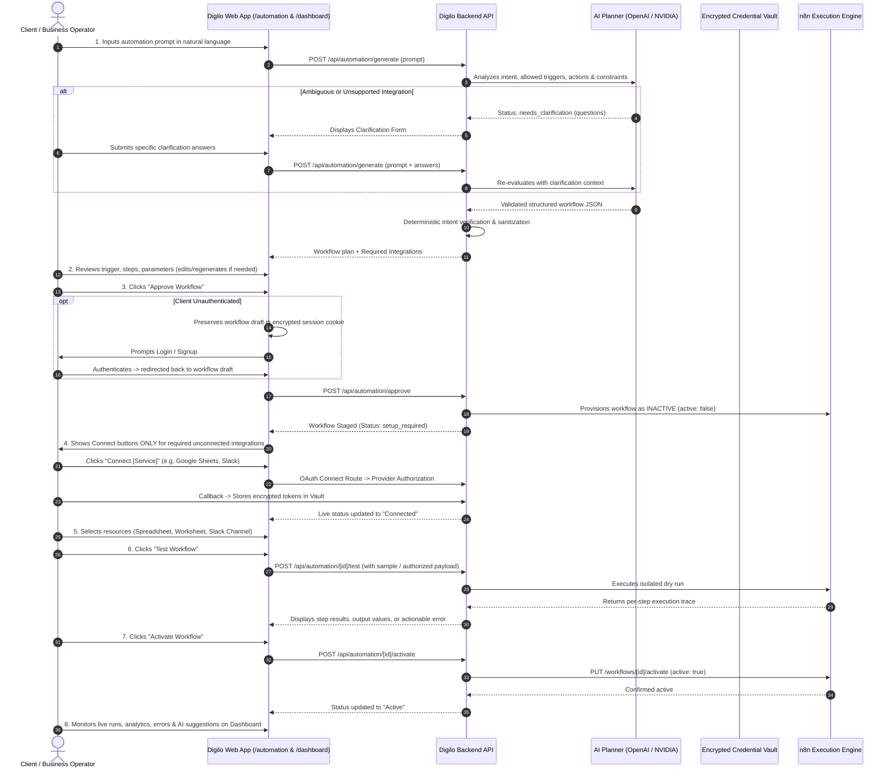
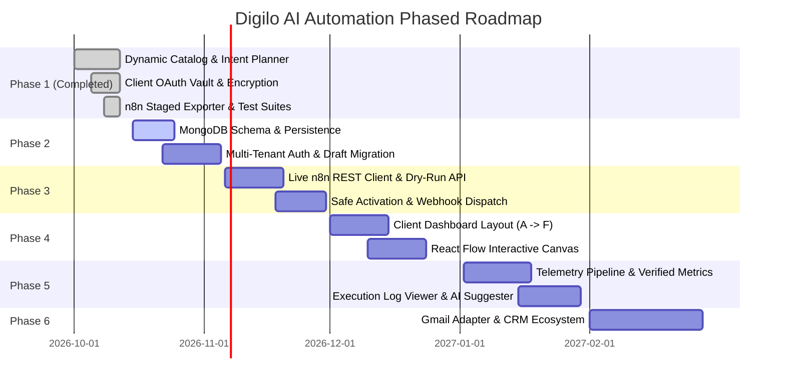

# DIGILO AI AUTOMATION PLANNER — PRODUCT REQUIREMENTS DOCUMENT (PRD)

**Document Version:** 2.0.0  
**Status:** Approved Architecture & Specification  
**Author:** Senior Product Manager, SaaS Architect & Workflow Automation Specialist  
**Last Updated:** October 2026  
**Target Audience:** Engineering, Product, Design, Operations, and Security Teams  

---

## 1. Executive Summary & Product Vision

### 1.1 Executive Summary
**DIGILO AI AUTOMATION** is an enterprise-grade, conversational workflow orchestration platform designed for modern business operations. It allows non-technical business operators, founders, and agency leads to express business workflow automation needs in natural language, review a deterministic and validated automation plan, safely authorize required third-party services, execute sandboxed tests, and monitor live automations from a unified client dashboard—all without ever interacting with the underlying execution engine (n8n).

DIGILO sits as the intelligent **Control Plane**, while a dedicated n8n instance operates as the isolated **Data Plane / Execution Engine**. DIGILO handles intent detection, constraint validation, credential storage, visual reviews, execution telemetry, and AI-driven workflow optimization, while delegating raw step-by-step job execution to n8n via secure, tenant-scoped credentials and definitions.

### 1.2 Product Vision
The paradigm shifts from "building workflows through node configuration" to **"describing business outcomes in natural language."**
A client can describe:
> *"When a new lead arrives through my website webhook, analyze the lead using AI to compute an urgency score and summary, save the result to Google Sheets, and notify my sales team on Slack."*

DIGILO deterministically:
1. Detects required integrations and actions without hallucination.
2. Formulates a schema-valid workflow graph.
3. Requests authorization **only** for services required by that workflow.
4. Stages an inactive, encrypted workflow in the execution engine.
5. Runs safe, isolated dry-run tests.
6. Activates the workflow upon explicit client approval.
7. Surfaces verified telemetry, per-step execution logs, and AI optimization suggestions within a client dashboard.

### 1.3 Technology Direction
- **Frontend Core**: Next.js 16 (App Router), React 19, Tailwind CSS, Framer Motion, Lucide Icons, and React Flow (workflow visualization).
- **Backend & APIs**: Next.js Route Handlers (Node.js runtime), Zod schema validators, and cryptographic utilities.
- **AI Planning Engine**: Server-side OpenAI API (or NVIDIA integration `/v1`) utilizing strict structured JSON outputs, deterministic intent extraction, and negative system prompt guardrails.
- **Database Layer**: MongoDB (Mongoose / MongoDB Node Driver) for users, workspaces, workflows, versions, connection references, executions, and analytics metrics *(Proposed transition from local encrypted JSON store)*.
- **Workflow Execution Engine**: n8n (self-hosted enterprise or dedicated cloud instance) accessed strictly via server-side REST API; zero administrative access or raw API credentials exposed to clients.
- **Supported Integration Catalog**: Webhook triggers, manual triggers, OpenAI / AI inference, Google Sheets, Slack, and Gmail *(Gmail designed in catalog; pending adapter completion)*.

---

## 2. Implementation Capability Matrix (Audit Baseline)

To maintain absolute architectural integrity, all platform capabilities are classified into one of four verified tiers:

| Component / Feature | Capability Tier | Implementation Location & Evidence |
| :--- | :--- | :--- |
| **Dynamic Integration Catalog** | `EXISTING & VERIFIED` | `src/lib/automation/catalog/`: definitions for Webhook, OpenAI, Google Sheets, Slack with parameter mappings and Zod schemas. |
| **Intent-Based AI Planner** | `EXISTING & VERIFIED` | `src/lib/ai/prompts.ts`, `src/lib/ai/automation-planner.ts`: intent extraction, clarification generation, and removal of unrequested actions. |
| **Workflow Schema & Deep Validator** | `EXISTING & VERIFIED` | `src/lib/automation/workflow-validator.ts`, `src/types/automation.ts`: topological, config, and registry validation. |
| **AES-256-GCM Token Encryption** | `EXISTING & VERIFIED` | `src/lib/automation/crypto.ts`: HKDF-SHA256 key derivation, 12-byte random IVs, authentication tags. |
| **OAuth State Tamper Protection** | `EXISTING & VERIFIED` | `src/lib/automation/oauth/oauth-state.ts`: HMAC-SHA256 signatures, 10-minute expiry, CSRF prevention. |
| **Google Sheets OAuth 2.0 Integration** | `EXISTING & VERIFIED` | `src/lib/automation/oauth/google-oauth.ts`, API routes `/google/connect`, `/callback`, `/spreadsheets`, `/sheets`, `/select`. |
| **Slack OAuth 2.0 Integration** | `EXISTING & VERIFIED` | `src/lib/automation/oauth/slack-oauth.ts`, API routes `/slack/connect`, `/callback`, `/channels`, `/select-channel`. |
| **Credential Storage (Workspace-Scoped)** | `EXISTING & VERIFIED` | `src/lib/automation/storage/integration-store.ts`: `.data/integrations.json` keyed by `${workspaceId}:${provider}`. |
| **n8n Export & Executability Engine** | `EXISTING & VERIFIED` | `src/lib/automation/n8n-exporter.ts`: node translation, parameter mapping, `meta.isExecutable` and `validationStatus`. |
| **Automated Regression Test Suite** | `EXISTING & VERIFIED` | 30 tests passing in `tests/`: workflow-system, integration-connection, dynamic-catalog, intent-selection-regression. |
| **Planner UI & Review Interface** | `EXISTING & VERIFIED` | `/automation`: prompt input, clarification form, step cards, integration cards, n8n JSON preview modal. |
| **MongoDB Persistence Layer** | `PROPOSED` | Documented schema for `users`, `workspaces`, `workflows`, `executions`, `metrics`. Not yet installed in `package.json`. |
| **Client Authentication & Sessions** | `PROPOSED` | Cookie session exists (`workspace-session.ts`), but full multi-user email/password or SSO auth is proposed. |
| **Live n8n REST API Orchestrator** | `PROPOSED` | `POST /api/automation/approve` stages JSON; live HTTP client for n8n workflow provisioning/activation is proposed. |
| **Client Dashboard (Sections A–F)** | `PROPOSED` | `/dashboard/workflows/[id]` layout with top canvas, controls, telemetry, execution history, and AI insights. |
| **Gmail OAuth & Action Adapter** | `PROPOSED` | Schema and catalog spec designed; live OAuth routes and n8n node adapters not yet implemented. |
| **WordPress / Webhook Ingestion Verification** | `PROPOSED` | Custom webhook endpoint with HMAC signature validation and payload verification. |
| **Arbitrary Website Admin Connect** | `NOT IMPLEMENTED` | Explicitly rejected. Universal website admin password sharing is insecure and architecturally prohibited. |

---

## 3. End-to-End Client Journey



### 3.1 Step-by-Step Lifecycle Details

1. **Natural Language Intake**: The client enters a plain-English request describing a business process.
2. **Intent Analysis & Negative Filtering**: The AI Planner extracts the trigger and actions. Deterministic code strips unprompted storage or notifications.
3. **Clarification Loop**: If the prompt references unsupported services (e.g., Shopify, Discord, Airtable) or lacks critical routing logic, specific clarification questions are returned.
4. **Structured Generation**: Returns a strictly typed `Workflow` object containing trigger parameters, ordered action steps, input/output mappings, and `required_integrations`.
5. **Deterministic Schema & Topological Validation**: The backend validates triggers against `TRIGGER_REGISTRY`, actions against `ACTION_REGISTRY`, and checks configuration completeness.
6. **Client Review & Editing**: The client can review step descriptions, configure parameters, add steps, reorder steps, or regenerate the plan.
7. **Explicit Approval**: Client approves the plan. **Approval does NOT mean activation.**
8. **Draft Preservation across Auth**: If unauthenticated, the client's workflow draft is stored in a secure encrypted cookie. Upon sign-in/registration, the draft is imported into their tenant workspace without data loss.
9. **n8n Inactive Provisioning**: A corresponding n8n workflow is provisioned in n8n with `active: false`. Node parameters are mapped via catalog adapters.
10. **Targeted Service Connection**: The UI renders connection cards **only** for services required by the workflow that are not yet connected or are expired.
11. **Resource Configuration**: The client chooses target spreadsheets, worksheets, Slack channels, or notification recipients.
12. **Pre-Flight Validation**: Validates OAuth token freshness, scope permissions, and destination availability.
13. **Safe Dry-Run Testing**: The client triggers a controlled test using synthetic or client-approved data.
14. **Per-Step Diagnostic Results**: The test output shows per-step input, execution duration, output data, and specific troubleshooting hints for any failure.
15. **Explicit Activation**: The client clicks "Activate Workflow". Only when all required integrations are connected and test validation passes does the backend enable the n8n webhook and schedule.
16. **Post-Activation Management**: The client monitors performance, reviews execution logs, retries eligible failed executions, pauses/resumes workflows, or safely disconnects services.

### 3.2 Alternate Paths & Failure Recovery

| Scenario | System Behavior & Client Guidance |
| :--- | :--- |
| **Unsupported Service Requested** | System intercepts request, avoids hallucinating fake actions, and offers supported alternatives (Google Sheets, Slack, Webhook). |
| **OAuth Authorization Denied / Cancelled** | Returns client to workflow review; sets integration state to `not_connected`; shows detailed permission guidance. |
| **Token Expired / Missing Refresh Token** | Marks integration as `expired`; displays prominent `Reconnect` button; retains workflow configuration so client does not have to reconfigure. |
| **Pre-Flight Test Failure** | Displays exact failed step (e.g., "Google Sheet 'Leads' missing column 'Urgency'"); marks workflow as `setup_required`; blocks activation. |
| **n8n Provisioning Failure** | Keeps workflow in `draft` state in Digilo; logs internal error; informs client that deployment staging is retrying without leaking server secrets. |
| **Client Abandons Workflow** | Draft remains securely saved under client's workspace for 30 days; accessible from dashboard drafts list. |

---

## 4. Client Dashboard Workflow-Detail Page Layout

The client workflow-detail page (`/dashboard/workflows/[id]`) must strictly adhere to the following top-to-bottom section order:

```text
+-----------------------------------------------------------------------------------+
|  SECTION A: VISUAL WORKFLOW CANVAS (n8n Node View at Top)                          |
|  - Saved Workflow Graph Nodes & Connections (Trigger -> AI Analyze -> Sheets)     |
|  - Status Badge: Saved Version (v1.0) | Proposal Draft (v1.1)                     |
|  - Actions: [View Workflow Details] [Edit Settings]                               |
+-----------------------------------------------------------------------------------+
|  SECTION B: WORKFLOW CONTROLS & STATUS                                            |
|  - State: [ACTIVE / PAUSED / SETUP REQUIRED / TESTING / FAILED]                   |
|  - Required Integrations Bar: [Webhook: Ready] [OpenAI: Ready] [Sheets: Connected] |
|  - Primary Controls: [Test Workflow]  [Activate / Pause]  [Save Draft]            |
+-----------------------------------------------------------------------------------+
|  SECTION C: VERIFIED ANALYTICS DASHBOARD                                          |
|  - Metrics: Total Runs | Success Rate | Avg Duration | Leads Ingested | Rows Added |
|  - Time Filter: [Last 24h] [Last 7d] [Last 30d] [Custom]                          |
|  - Verified Data Sources (Zero Fabricated Figures / Clear Empty State)            |
+-----------------------------------------------------------------------------------+
|  SECTION D: EXECUTION HISTORY & STEP DIAGNOSTICS                                  |
|  - Execution Table: Timestamp | Duration | Status | Trigger Event | Step Results  |
|  - Actionable Errors & Safe Retry | PII Redacted Payload Inspection               |
+-----------------------------------------------------------------------------------+
|  SECTION E: AI WORKFLOW ANALYSIS                                                  |
|  - Plain-Language Explanation: How data enters, transforms, and routes            |
|  - Diagnostic Health Summary based on real execution logs                         |
+-----------------------------------------------------------------------------------+
|  SECTION F: AI IMPROVEMENT SUGGESTIONS                                            |
|  - Evidence-Based Recommendations (e.g. Rate-limit alert, Schema mismatch)        |
|  - Actions: [Review Proposed Changes] [Apply as Draft Version] [Dismiss]          |
+-----------------------------------------------------------------------------------+
```

### 4.1 Section A: Visual Workflow Canvas (Top of Page)
- **Positioning**: Must be the very first section at the top of the detail page, before analytics, history, or AI suggestions.
- **Canvas Visualizer**: Rendered using React Flow (or clean SVG interactive node canvas).
- **Node Representation**:
  - **Trigger Node**: Displays trigger icon, source (e.g., "Website Webhook"), and event name.
  - **Action Nodes**: Displays action type, integration logo, service operation, and mapped destination (e.g., "Append Row -> 'Website Leads'").
  - **Edge Connectors**: Directed arrows showing linear or branching execution paths.
- **Draft vs. Production Separation**:
  - Clear visual indicator: `Active Production Version (v1.0)` in electric-lime badge vs. `Proposed Version (Draft v1.1)` in amber dashed outline.
- **Editing Capabilities**:
  - Read-only visual canvas by default.
  - Click-to-inspect step parameters in a side drawer.
  - Safe settings editor: clients can adjust prompts, channel names, and sheet names without accessing raw n8n nodes or administrative endpoints.
  - **Rule**: Saving edits creates a new **proposed draft version**; changes must never silently overwrite or mutate an active production workflow.

### 4.2 Section B: Workflow Controls & Status
- **Truthful Status Display**:
  - `Draft`: Formulated workflow, pending client review.
  - `Setup Required`: Approved, but one or more required integrations are unconnected, expired, or unconfigured.
  - `Testing`: Dry-run execution in progress.
  - `Active`: Production workflow confirmed active in n8n backend.
  - `Paused`: Live intake temporarily stopped; incoming events queued or dropped per policy.
  - `Failed`: Critical runtime failure encountered (e.g., revoked OAuth scope).
  - *Constraint: Never display `Active` unless the backend confirms n8n workflow `active === true`.*
- **Required Integration Bar**: Compact badges displaying each required integration with its live verified state (`Connected`, `Expired`, `Not Connected`).
- **Control Actions**:
  - **Test Workflow**: Triggers safe, sandboxed execution with test payload.
  - **Activate Workflow**: Enabled **only** when all integrations are connected, configurations valid, and at least one test has passed.
  - **Pause / Resume**: Toggles live n8n workflow execution safely.
  - **Regenerate Plan**: Re-invokes planner to modify structure.

### 4.3 Section C: Verified Analytics Dashboard
- **Metric Definitions & Strict Sources of Truth**:

| Metric | Source of Truth | Computation & Business Logic |
| :--- | :--- | :--- |
| **Total Runs** | n8n Execution Records | Count of all executions initiated for this tenant workflow ID. |
| **Successful Runs** | n8n Execution Records | Executions where all workflow steps returned exit code `0` / success. |
| **Failed Runs** | n8n Execution Records | Executions terminating with error in any step. |
| **Success Rate** | Computed | `(Successful Runs / Total Runs) * 100`. Displays `N/A` if Total Runs is 0. |
| **Avg Execution Duration** | Execution Timestamps | `sum(endTime - startTime) / completedRuns`. Reported in milliseconds/seconds. |
| **Leads Ingested** | Trigger Execution Output | Count of unique, valid webhook events received after deduplication. |
| **Sheets Rows Written** | Google Sheets Action Log | Verified count of successful `google_sheets.add_row` responses. *Never inferred from total runs.* |
| **Notifications Delivered** | Slack Action Log | Verified count of successful `slack.send_message` responses with valid `message_ts`. |
| **Historical Trends** | Daily Aggregation Rollups | Time-series bar/area chart filterable by Last 24 Hours, Last 7 Days, Last 30 Days, or Custom Range. |

- **Empty State Integrity**: If a workflow has 0 runs, display an educational empty state: *"No executions recorded yet. Activate your workflow or run a test to view performance metrics."* Never show fabricated placeholder numbers or simulated curves.

### 4.4 Section D: Execution History & Step Diagnostics
- **Execution Log Table**:
  - Execution ID, Timestamp, Total Duration, Status (`Success`, `Failed`, `Running`, `Cancelled`).
  - Trigger Summary: E.g., `Webhook: Form Submission (lead_id: lead_883)`.
- **Per-Step Execution Drilldown**:
  - Expanding an execution row displays every step executed in sequence:
    - Step 1: Webhook Trigger (22ms) — Inbound payload validated.
    - Step 2: AI Lead Analysis (1,420ms) — Urgency score: 85, Summary generated.
    - Step 3: Google Sheets Row (310ms) — Row appended to Sheet1.
    - Step 4: Slack Alert (180ms) — Message posted to `#sales-leads`.
- **Sensitive Data Redaction**: PII (emails, phone numbers, addresses) and secret tokens are masked in logs (e.g. `j***@company.com`).
- **Actionable Remediation**: On step failure, display clear error causes and fixes:
  - *Bad: "Error: 403 Forbidden"*
  - *Good: "Google Sheets permission error: Digilo lacks edit access to spreadsheet 'Website Leads'. Reconnect Google Sheets or share spreadsheet with authorized account."*
- **Safe Retry**: Single-execution manual retry allowed only for idempotent steps where partial writes are safely handled.

### 4.5 Section E: AI Workflow Analysis
- **Purpose**: Translates complex execution telemetry and node connections into plain English for business stakeholders.
- **Narrative Content**:
  - **Intake Description**: Explains how inbound data enters the workflow.
  - **Data Transformation**: Describes how the AI model interprets, scores, and transforms variables.
  - **Outbound Distribution**: Clarifies which connected platforms receive the processed outputs.
  - **Operational Health**: Evaluates whether execution volume is within normal bounds and flags bottlenecks (e.g., AI inference accounting for 80% of total latency).
- **Truth In Telemetry**: AI analysis must operate strictly on saved workflow configurations and verified execution logs. Inferences must be labeled: *"Based on 42 executions over the past 7 days..."*

### 4.6 Section F: AI Improvement Suggestions
- **Evidence-Based Optimization**: Recommendations generated only when verified by runtime logs.
- **Suggestion Structure**:
  - **Identified Opportunity**: E.g., *"Lead qualification prompt exhibits high latency."*
  - **Execution Evidence**: E.g., *"Step 'AI Analyze' averages 3.8s over the last 150 runs, with 2 timeout warnings."*
  - **Proposed Modification**: Optimize extraction prompt tokens and adjust temperature to 0.
  - **Anticipated Benefit**: ~45% reduction in execution latency; lower token usage.
  - **Potential Trade-offs**: Slightly more concise summary format.
- **Strict Human-in-the-Loop Governance**:
  - Actions available: `Review Changes`, `Apply as Proposed Version`, `Dismiss`.
  - **Zero Silent Mutation**: Applying a suggestion creates a **new proposed draft version** (e.g., v1.1). The client must review, validate, test, and explicitly approve the change before it replaces the active production workflow.

---

## 5. Dynamic Integration Catalog & Adapters

### 5.1 Extensible Registry Architecture
The integration catalog is structured as a modular registry (`src/lib/automation/catalog/types.ts` and `index.ts`), separating integration definitions, action contracts, authentication requirements, and n8n execution adapters.

```typescript
export interface IntegrationDefinition {
  id: string;                                   // e.g. "google_sheets"
  name: string;                                 // e.g. "Google Sheets"
  category: IntegrationCategory;                // e.g. "Databases & Spreadsheets"
  description: string;
  icon: string;
  authMethod: "oauth2" | "api_key" | "none";
  oauthConfig?: OAuthConfig;
  triggers: CatalogTrigger[];
  actions: CatalogAction[];
  executionAdapter: ExecutionAdapter;           // n8n parameter & credential mapping
  documentationUrl?: string;
  setupInstructions?: string[];
}
```

### 5.2 Supported Integrations Specification

#### 1. Digilo Webhook & Manual Trigger (`EXISTING & VERIFIED`)
- **Trigger IDs**: `webhook` (HTTP POST), `manual` (dashboard-triggered).
- **Auth Method**: `none` / Authenticated endpoint token.
- **Execution Adapter**: Maps to `n8n-nodes-base.webhook` (path: `digilo-webhook`, method: `POST`, responseCode: `200`) and `n8n-nodes-base.manualTrigger`.

#### 2. OpenAI / AI Intelligence (`EXISTING & VERIFIED`)
- **Action ID**: `ai.analyze`.
- **Auth Method**: Server-managed API Key vault.
- **Execution Adapter**: Maps to `n8n-nodes-base.openAi` (operation: `chat`, model: `gpt-4o-mini`, temperature: `0`).
- **Config Fields**: `prompt` (string, required), `model` (string, default: `gpt-4o-mini`).

#### 3. Google Sheets (`EXISTING & VERIFIED`)
- **Action ID**: `google_sheets.add_row`.
- **Auth Method**: `oauth2` via Google Cloud Console.
- **Scopes**: `https://www.googleapis.com/auth/spreadsheets`.
- **Config Fields**: `spreadsheet` (string, required), `sheetName` (string, required).
- **Execution Adapter**: Maps to `n8n-nodes-base.googleSheets` (operation: `append`, sheetName, columns).

#### 4. Slack (`EXISTING & VERIFIED`)
- **Action ID**: `slack.send_message`.
- **Auth Method**: `oauth2` via Slack App Directory.
- **Scopes**: `chat:write`, `chat:write.public`, `channels:read`, `groups:read`, `team:read`.
- **Config Fields**: `channel` (string, required), `message` (string, required).
- **Execution Adapter**: Maps to `n8n-nodes-base.slack` (operation: `postMessage`, channel, text).

#### 5. Gmail (`PROPOSED / CATALOG READY`)
- **Action ID**: `gmail.send_email`.
- **Auth Method**: `oauth2` via Google Cloud Console (`https://www.googleapis.com/auth/gmail.send`).
- **Config Fields**: `to` (string, required), `subject` (string, required), `body` (string, required).
- **Status**: Catalog schema and validator defined; live OAuth route and n8n adapter to be deployed in Phase 6.

### 5.3 Website Lead Intake Architecture
To integrate website leads without compromising client security:
1. **Custom Websites**: Ingested via unique tenant Webhook URL (`https://api.digilo.tech/api/v1/intake/[workspaceId]/[webhookSecret]`). Authenticated using optional shared HMAC header.
2. **WordPress**: Ingested via standard webhook dispatch (WP Webhooks plugin, Elementor Webhooks, Gravity Forms Webhooks, or Contact Form 7 Webhook extension).
3. **Third-Party Platforms (Shopify, Webflow, Typeform)**: Ingested via official webhook triggers or direct platform connectors when implemented.
4. **Absolute Security Constraint**: **Digilo will NEVER prompt clients for website CMS admin usernames or passwords.** Intake operates exclusively through webhooks and standard authorized endpoints.
5. **Future Events vs. Historical Import**: Webhook intake captures live events from the moment of activation forward. Historical lead backfills require an explicit, separately authorized CSV import utility.

---

## 6. n8n Execution Engine Architecture

### 6.1 Control Plane vs. Data Plane Separation
- **Digilo (Control Plane)**:
  - Generates workflows from natural language.
  - Validates schemas, parameters, and credentials.
  - Manages client OAuth connections and encryption keys.
  - Displays dashboard analytics, logs, and suggestions.
  - Holds zero execution worker threads.
- **n8n (Data Plane)**:
  - Dedicated instance running in private VPC or isolated container.
  - Receives workflow JSON only via Digilo Backend API.
  - Executes jobs, triggers webhooks, handles exponential backoffs.
  - Pushes execution summaries back to Digilo via internal webhook callback.
  - Never accessible directly by client browsers.

### 6.2 Workflow Staging & Inactive Provisioning
When a client approves a workflow in Digilo:
1. Digilo compiles the workflow into an n8n-compatible payload using `convertDigiloWorkflowToN8n()`.
2. Digilo calls n8n REST API: `POST /api/v1/workflows` with `{ "name": "Digilo-[WorkspaceId]-[WorkflowId]", "active": false, "nodes": [...], "connections": {...} }`.
3. n8n returns `n8nWorkflowId`.
4. The workflow remains **inactive** until client authorization, resource selection, and safe test execution succeed.

### 6.3 Credential Binding
- Digilo creates/provisions credentials inside n8n via `POST /api/v1/credentials` using server-side administrative tokens.
- Digilo passes decrypted tokens from the vault directly over internal mTLS/VPC network to n8n, receiving an `n8nCredentialId`.
- The exported workflow JSON references only `{ "id": n8nCredentialId, "name": "Digilo Client" }`.
- **Zero raw client tokens, client secrets, or refresh tokens are ever exposed to frontend clients or included in client-visible JSON.**

### 6.4 Safe Testing Protocol
1. Client initiates "Test Workflow".
2. Digilo generates a synthetic lead payload matching the trigger schema.
3. Digilo invokes n8n manual test endpoint: `POST /api/v1/workflows/[n8nWorkflowId]/run` with payload.
4. n8n executes steps in a sandboxed run and returns full step telemetry.
5. Digilo verifies that all steps returned exit code 0 and records the test run as valid.
6. The test output is rendered to the client with full step-by-step audit.

---

## 7. Security, Tenant Isolation & Secret Management

### 7.1 Multi-Tenant Isolation
- **Tenant Partitioning**: Every workspace possesses an immutable UUID (`workspaceId`).
- **Database Indexing**: All database collections (`workflows`, `credentials`, `executions`, `metrics`) are compound-indexed with `{ workspaceId: 1 }`.
- **Query Authorization**: Server-side session middleware injects `workspaceId` into all database operations. Cross-tenant access attempts immediately terminate with HTTP `403 Forbidden` and trigger a security audit log.

### 7.2 Cryptographic Key Management & Storage
- **Algorithm**: AES-256-GCM (Authenticated Encryption).
- **Key Derivation**: HKDF-SHA256 derives 256-bit encryption keys from `TOKEN_ENCRYPTION_KEY`.
- **Unique IVs**: Every token is encrypted with a cryptographically secure, random 12-byte initialization vector (`crypto.randomBytes(12)`).
- **Authentication Tag**: A 16-byte GCM authentication tag verifies ciphertext integrity upon decryption. Any tampered ciphertext is rejected with an exception.
- **Zero Client Leakage**: OAuth tokens never touch `localStorage`, `sessionStorage`, client React state, or client-side network payloads.

### 7.3 OAuth Security & CSRF Defense
- **HMAC-SHA256 State Signatures**: OAuth `state` parameters are formed as `base64url(payload).hmacSignature`.
- **Time-Bounded Expiry**: State parameters expire 10 minutes after generation.
- **Provider & Workspace Binding**: The state explicitly binds `workspaceId` and `provider`. Callbacks with mismatched state or altered signatures are rejected.
- **Least-Privilege Scopes**: Only scopes strictly required for workflow actions are requested (e.g. Google Sheets only requests `spreadsheets`, not Drive root or Gmail).

---

## 8. Data Models & Schemas

### 8.1 Workflow Schema (`src/types/automation.ts`)
```typescript
export interface Workflow {
  id?: string;
  name: string;
  description: string;
  version?: string;                             // e.g. "1.0.0"
  status?: "draft" | "setup_required" | "testing" | "approved" | "active" | "paused" | "failed";
  trigger: WorkflowTrigger;
  steps: WorkflowStep[];
  required_integrations: string[];
  n8nWorkflowId?: string;
  approvedAt?: string;
  activatedAt?: string;
  createdAt?: string;
  updatedAt?: string;
}

export interface WorkflowTrigger {
  type: "webhook" | "manual";
  source: string;                               // e.g. "Website Contact Form"
  event: string;                                // e.g. "lead_submitted"
  description?: string;
  config?: Record<string, unknown>;
}

export interface WorkflowStep {
  id: string;                                   // e.g. "step_1"
  name: string;
  type: "action";
  action: ActionType;                           // e.g. "ai.analyze", "google_sheets.add_row", "slack.send_message"
  description: string;
  config: Record<string, unknown>;
}
```

### 8.2 Execution Record Schema (MongoDB: `executions`)
```typescript
export interface ExecutionRecord {
  id: string;
  workspaceId: string;
  workflowId: string;
  n8nExecutionId: string;
  status: "success" | "failed" | "running" | "cancelled";
  startedAt: string;
  finishedAt?: string;
  durationMs: number;
  triggerEvent: {
    source: string;
    event: string;
    redactedSummary: string;
  };
  stepResults: Array<{
    stepId: string;
    stepName: string;
    action: string;
    status: "success" | "failed" | "skipped";
    durationMs: number;
    inputSummary: Record<string, unknown>;      // Redacted
    outputSummary: Record<string, unknown>;     // Redacted
    errorMessage?: string;
    errorRemediation?: string;
  }>;
  metricsEffect: {
    leadsIngested: number;
    sheetsRowsWritten: number;
    notificationsDelivered: number;
  };
  retryEligible: boolean;
  retryCount: number;
}
```

### 8.3 Integration Credential Record Schema (Vault: `integrations`)
```typescript
export interface StoredIntegrationRecord {
  workspaceId: string;
  provider: "google_sheets" | "slack" | "gmail";
  status: "connected" | "expired";
  account: {
    email?: string;
    name?: string;
    workspaceName?: string;
    selectedSpreadsheetId?: string;
    selectedSpreadsheetName?: string;
    selectedSheetName?: string;
    selectedChannelId?: string;
    selectedChannelName?: string;
  };
  encryptedTokens: {
    accessTokenCipher: string;
    refreshTokenCipher?: string;
    expiresAt?: number;
  };
  createdAt: string;
  updatedAt: string;
}
```

---

## 9. API & Route Inventory

| HTTP Method & Endpoint | Status | Auth Required | Purpose & Functional Contract |
| :--- | :--- | :--- | :--- |
| `POST /api/automation/generate` | `EXISTING & VERIFIED` | Optional (Guest Cookie) | Accepts prompt + optional clarification answers; returns validated workflow plan. |
| `POST /api/automation/validate` | `EXISTING & VERIFIED` | Optional | Validates workflow JSON against Zod schema and topological catalog rules. |
| `POST /api/automation/approve` | `EXISTING & VERIFIED` | Workspace Session | Approves workflow; computes required integrations; generates inactive n8n export JSON. |
| `GET /api/automation/integrations` | `EXISTING & VERIFIED` | Workspace Session | Returns live connection status (`connected`, `not_connected`, `expired`) for workspace. |
| `POST /api/automation/integrations/disconnect` | `EXISTING & VERIFIED` | Workspace Session | Revokes tokens and purges stored credentials for specified provider. |
| `GET /api/automation/integrations/google/connect` | `EXISTING & VERIFIED` | Workspace Session | Generates Google OAuth redirect URL with signed HMAC state parameter. |
| `GET /api/automation/integrations/google/callback` | `EXISTING & VERIFIED` | Public Callback | Validates OAuth state, exchanges code for tokens, encrypts and stores in vault. |
| `GET /api/automation/integrations/google/spreadsheets` | `EXISTING & VERIFIED` | Workspace Session | Fetches accessible Google Spreadsheets for the connected user account. |
| `GET /api/automation/integrations/google/sheets` | `EXISTING & VERIFIED` | Workspace Session | Fetches worksheets for a given spreadsheet ID. |
| `POST /api/automation/integrations/google/select` | `EXISTING & VERIFIED` | Workspace Session | Saves selected spreadsheet and worksheet destinations in account metadata. |
| `GET /api/automation/integrations/slack/connect` | `EXISTING & VERIFIED` | Workspace Session | Generates Slack OAuth redirect URL with signed HMAC state parameter. |
| `GET /api/automation/integrations/slack/callback` | `EXISTING & VERIFIED` | Public Callback | Validates OAuth state, exchanges code for bot token, encrypts and stores in vault. |
| `GET /api/automation/integrations/slack/channels` | `EXISTING & VERIFIED` | Workspace Session | Fetches public and private channels accessible by the authorized bot. |
| `POST /api/automation/integrations/slack/select-channel` | `EXISTING & VERIFIED` | Workspace Session | Saves selected destination Slack channel in account metadata. |
| `GET /api/automation/workflows` | `PROPOSED` | Authenticated Session | Lists all workflows for tenant workspace (with status and summary). |
| `GET /api/automation/workflows/[id]` | `PROPOSED` | Authenticated Session | Fetches workflow detail, saved version, and active version status. |
| `POST /api/automation/workflows/[id]/test` | `PROPOSED` | Authenticated Session | Triggers dry-run execution in n8n; returns per-step telemetry. |
| `POST /api/automation/workflows/[id]/activate` | `PROPOSED` | Authenticated Session | Verifies checks, activates n8n workflow (`active: true`), enables webhooks. |
| `POST /api/automation/workflows/[id]/pause` | `PROPOSED` | Authenticated Session | Pauses live n8n workflow (`active: false`). |
| `GET /api/automation/workflows/[id]/analytics` | `PROPOSED` | Authenticated Session | Returns verified execution metrics and historical rollups. |
| `GET /api/automation/workflows/[id]/executions` | `PROPOSED` | Authenticated Session | Returns paginated execution history with redacted payloads. |
| `POST /api/automation/workflows/[id]/retry` | `PROPOSED` | Authenticated Session | Retries an eligible failed execution. |
| `POST /api/automation/workflows/[id]/suggest` | `PROPOSED` | Authenticated Session | Generates AI improvement suggestions based on real execution logs. |

---

## 10. Error Handling, Observability & Edge Cases

### 10.1 User-Facing Error Taxonomy
All system errors are mapped to structured, actionable user feedback:

```json
{
  "success": false,
  "error": {
    "code": "INTEGRATION_TOKEN_EXPIRED",
    "message": "Your Google Sheets authorization has expired.",
    "actionableRemediation": "Click 'Reconnect Google Sheets' in the integration settings to re-authorize access.",
    "stepId": "step_2",
    "provider": "google_sheets"
  }
}
```

### 10.2 Edge Case Matrix

| Failure Mode | Detection Point | Graceful Recovery Protocol |
| :--- | :--- | :--- |
| **OpenAI / NVIDIA Timeout** | 60s AbortController | Catches timeout; returns `TIMEOUT` error code; displays "AI planning timed out. Please try again or refine your prompt." |
| **Malformed AI JSON Output** | Zod Schema Parser | Re-attempts extraction; if parse fails, returns structured `JSON_PARSE_ERROR` without throwing unhandled exceptions. |
| **Expired OAuth Token on Run** | API / n8n webhook | Catches 401 error; marks connection as `expired`; surfaces alert banner on dashboard with direct Reconnect button. |
| **Destination Resource Deleted** | Dry-Run Test / Run | Detects missing spreadsheet or deleted Slack channel; guides user to re-select target destination via dropdown. |
| **High Webhook Ingestion Volume** | Ingestion Edge Route | Enforces per-tenant rate limit (100 req/sec standard); returns HTTP 429 with retry header; prevents n8n queue exhaustion. |
| **Database Network Partition** | Storage Layer | Degrades gracefully to in-memory/cached state; logs critical alert to operational monitoring; rejects new deployments safely. |

---

## 11. Acceptance Criteria & Test Plan

### 11.1 Acceptance Criteria
- **AC-1 (Dynamic Intent Selection)**: A prompt requesting only AI analysis (e.g. "analyze lead via webhook and return score/summary") must result in `steps: ["ai.analyze"]` and `required_integrations: ["webhook", "openai"]`. Google Sheets and Slack must not appear in steps, connection cards, or descriptions.
- **AC-2 (Accurate Descriptions)**: Generated workflow descriptions must describe only the actual steps present. Never mention Google Sheets or Slack when those steps are absent.
- **AC-3 (Targeted Connection Requests)**: The UI must display Connect buttons exclusively for integrations required by the current workflow that are not connected.
- **AC-4 (Complete Workflow Replacement)**: Regenerating a workflow must completely unmount previous approval, editing, and n8n export states.
- **AC-5 (Zero Secret Exposure)**: Exported workflow JSON, network requests, client storage, and AI prompts must contain zero access tokens, refresh tokens, client secrets, or master encryption keys.
- **AC-6 (Execution Readiness Honest Reporting)**: A workflow must report `meta.isExecutable: false` with specific `missingCredentials` until all required integrations are connected and verified.
- **AC-7 (Dashboard Top Canvas)**: On `/dashboard/workflows/[id]`, the visual workflow canvas must render at the top (Section A) before analytics (Section C) or AI suggestions (Section F).

### 11.2 Automated Test Plan
The project maintains 30 verified automated tests across 4 comprehensive suites (`npm test`):
1. **`tests/workflow-system.test.ts` (7 tests)**: Full multi-step workflows, single-step notifications, clarification handling, unsupported action rejection, required field validation, and dynamic editing.
2. **`tests/integration-connection.test.ts` (9 tests)**: AES-256-GCM encryption/decryption roundtrips, HMAC state signatures, workspace isolation, OAuth URL builders, token refresh, and n8n secret omission.
3. **`tests/dynamic-catalog.test.ts` (9 tests)**: Dynamic catalog registration, runtime extensibility, single/multi integration detection, connection readiness, and tenant isolation in export.
4. **`tests/intent-selection-regression.test.ts` (5 tests)**:
   - Webhook + AI + score/summary: excludes Sheets and Slack.
   - Webhook + AI + save to Sheets: includes Sheets, excludes Slack.
   - Webhook + AI + notify Slack: includes Slack, excludes Sheets.
   - Webhook + AI + Sheets + Slack: includes both.
   - Regenerate from Sheets workflow to AI-only: completely removes Sheets.

---

## 12. Phased Implementation Roadmap & Dependencies



### Phase 1: Dynamic Catalog, Intent Planner & Vault (`COMPLETED & VERIFIED`)
- Centralized integration catalog (`types.ts`, `index.ts`).
- Intent-based AI Planner with negative prompt constraints and deterministic sanitization.
- Client OAuth Connection Vault with AES-256-GCM encryption and HMAC state verification.
- Google Sheets and Slack OAuth routes and destination pickers.
- n8n export generation and compatibility checking.
- Automated test suites (30/30 tests passing).

### Phase 2: MongoDB Persistence & Authentication (`NEXT PHASE`)
- **Dependencies**: Completed Phase 1 schemas.
- Install `mongoose` or MongoDB Node Driver.
- Provision MongoDB collections: `users`, `workspaces`, `workflows`, `workflow_versions`, `executions`, `metrics`.
- Implement user authentication (email/password and Google SSO) with tenant workspace binding.
- Draft workflow preservation across login/registration.

### Phase 3: Live n8n REST Client & Execution Orchestrator
- **Dependencies**: Phase 2 workspace database.
- Build internal n8n API client service: create, update, activate, pause workflows.
- Implement isolated dry-run test execution route (`/api/automation/workflows/[id]/test`).
- Implement safe activation route (`/api/automation/workflows/[id]/activate`).

### Phase 4: Client Dashboard Workflow-Detail Layout
- **Dependencies**: Phase 3 live workflow state.
- Implement `/dashboard/workflows/[id]` following strict top-to-bottom layout:
  - **Section A**: Visual workflow canvas at the top.
  - **Section B**: Workflow controls and status.
  - **Section C**: Verified analytics dashboard.
  - **Section D**: Execution history with redacted payloads.
  - **Section E**: Plain-language AI workflow analysis.
  - **Section F**: Evidence-based AI improvement suggestions.

### Phase 5: Verified Telemetry, Execution Logs & AI Optimization Loop
- **Dependencies**: Phase 4 dashboard.
- Set up n8n execution callback receiver to ingest runtime logs into MongoDB.
- Build aggregation pipeline for verified metrics (runs, leads, rows, alerts).
- Implement proposed version branching when applying AI suggestions.

### Phase 6: Ecosystem Expansion
- **Dependencies**: Stable core platform.
- Deploy live OAuth routes and n8n adapters for Gmail (`gmail.send_email`).
- Implement custom authenticated website intake webhook with signature verification.
- Support CRMs (HubSpot) and database connectors.

---

## 13. Known Gaps, Assumptions, Risks & Out-of-Scope Items

### 13.1 Known Gaps (Explicitly Documented)
1. **Database Persistence**: Currently uses `.data/integrations.json` for credential persistence and client state for review workflows. MongoDB is required for multi-tenant production persistence.
2. **Direct n8n REST Client**: Workflows are currently exported and validated as standard n8n JSON; live n8n HTTP provisioning and activation endpoints are pending Phase 3.
3. **Interactive React Flow Canvas**: The UI currently utilizes structured step cards and an n8n JSON viewer; full graphical node dragging/zooming is slated for Phase 4.
4. **Gmail OAuth Routes**: Gmail action is registered in catalog types; live Google OAuth client routes for Gmail scopes are scheduled for Phase 6.

### 13.2 Key Assumptions
- Clients possess valid Google Workspace and Slack accounts with administrative permissions to install OAuth applications.
- The self-hosted n8n instance is accessible internally by the Digilo Next.js backend over a secure private network (VPC).
- OpenAI / NVIDIA API endpoints maintain >= 99.9% availability and accept structured JSON output constraints.

### 13.3 Architectural Risks & Mitigations
- **Risk: Downstream Execution Latency in n8n**:  
  *Mitigation*: Webhook intake returns HTTP 200 immediately upon queuing event; executions run asynchronously in n8n workers.
- **Risk: Client OAuth Token Revocation**:  
  *Mitigation*: Pre-flight checks verify token status prior to execution. Expired tokens transition workflow state to `setup_required` with clear client alerts.
- **Risk: AI Hallucinations in Workflow Proposals**:  
  *Mitigation*: Strict negative prompting paired with deterministic application code validation ensures zero unprompted actions or unsupported integrations.

### 13.4 Out-of-Scope Items (Will Not Be Built)
- **Arbitrary Website Admin Credential Collection**: Never collect CMS/WordPress admin passwords. Intake is strictly webhook/API-driven.
- **Client Access to Raw n8n Administration**: Clients will never be provided access to the n8n backend interface, raw API keys, or underlying workflow JSON.
- **Universal Unrestricted Visual Code Execution**: Arbitrary JavaScript code execution nodes are strictly blocked in client-generated workflows to prevent sandbox escapes and SSRF.
